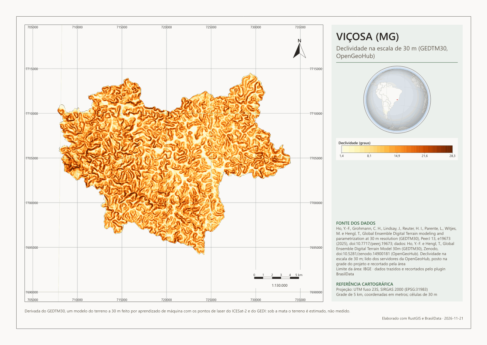

# Derivadas do relevo (GEDTM30)

<!-- Gerado por scripts/gerar.py a partir do fontes.csv e do fichas.csv; não edite à mão. -->

As variáveis do relevo do GEDTM30 (OpenGeoHub), o terreno global a 30 m feito por aprendizado de máquina com os pontos de laser do ICESat-2 e do GEDI: declividade, índice topográfico de umidade, diferença da elevação média, rugosidade, curvaturas, índice de forma, aberturas, sombreamento, geomorfons e fator LS, algumas também nas escalas de 480 e 960 m.

*Mapa exemplo: Viçosa (MG), feito com o plugin.*

| | |
|---|---|
| **Onde na aba** | Meio físico › Relevo |
| **Fonte** | OpenGeoHub |
| **Período** | terreno de 2000 a 2022 (v1.0, de dezembro de 2024; o sombreamento e as escalas de 480 e 960 m do TWI, da diferença da elevação média, da rugosidade e das curvaturas mínima e máxima, da v1.2, de março de 2026). |
| **Resolução ou escala** | 0,00025° (cerca de 30 m); nas escalas maiores, 240, 480 ou 960 m; numa área grande, a pirâmide do arquivo. |
| **Unidades** | graus (declividade, rugosidade e aberturas), m (diferença da elevação média), 1/m (curvaturas), classe (geomorfons) ou índice sem unidade. |
| **Legenda** | Escala contínua: a declividade do amarelo ao marrom; as curvaturas e a diferença da elevação média do azul (côncavo, baixo) ao vermelho (convexo, alto); o TWI do amarelo ao azul; os geomorfons em dez classes, de 1 plano a 10 depressão. |
| **Cuidados de uso** | Sob a mata densa o terreno é estimado, não medido. A elevação do GEDTM30 e as escalas de 60, 120 e 240 m (fora os geomorfons e a curvatura anelar) ainda não vêm: nesses arquivos o cabeçalho fica no fim, e o RustGIS não o lê por partes. Numa escala maior que a grade, cada célula do dado se repete na grade. |
| **Licença** | CC BY 4.0 |
| **Citação** | Ho, Y.-F. et al., Global Ensemble Digital Terrain modeling and parametrization at 30 m resolution (GEDTM30), PeerJ 13, e19673 (2025), doi:10.7717/peerj.19673; dados: Ho, Y.-F. e Hengl, T., doi:10.5281/zenodo.14900181. |
| **App desktop** | sim |
| **App web** | sim (os servidores da OpenGeoHub liberam a leitura pelo navegador); precisa de um RustGIS depois da 0.5.0. |

[Todas as camadas](README.md)
