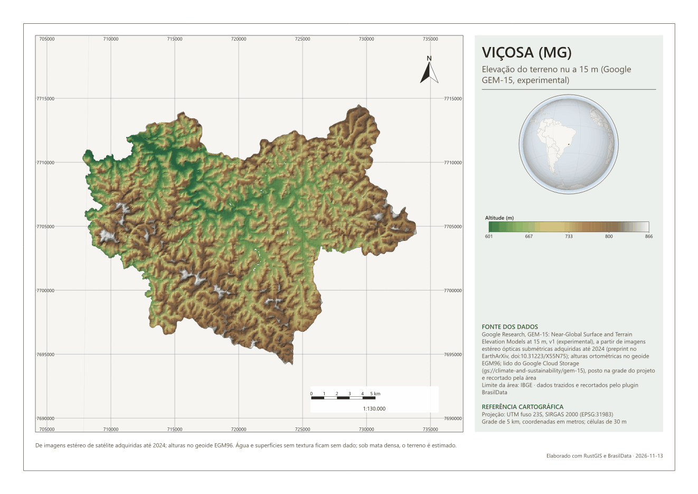

# Elevação a 15 m (Google GEM-15)

<!-- Gerado por scripts/gerar.py a partir do fontes.csv e do fichas.csv; não edite à mão. -->

Os modelos de elevação do Google a 15 m (GEM-15, experimental): o terreno nu (DTM), a superfície (DSM) ou a altura acima do terreno.

*Mapa exemplo: Viçosa (MG), feito com o plugin.*

| | |
|---|---|
| **Onde na aba** | Meio físico › Relevo |
| **Fonte** | Google Research |
| **Período** | imagens estéreo de satélite até 2024 |
| **Resolução ou escala** | 15 m |
| **Unidades** | metros, no geoide EGM96 |
| **Legenda** | Escala contínua de cores. |
| **Cuidados de uso** | Produto experimental: água e superfícies sem textura ficam sem dado, e o DTM é pior sob mata densa. |
| **Licença** | CC-BY 4.0 |
| **Citação** | Google Research, GEM-15: Near-Global Surface and Terrain Elevation Models at 15 m, v1 (experimental), doi:10.31223/X55N75. |
| **App desktop** | sim |
| **App web** | a confirmar |

[Todas as camadas](README.md)
