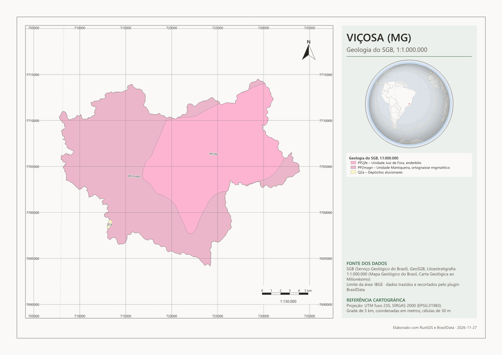

# Geologia do SGB

<!-- Gerado por scripts/gerar.py a partir do fontes.csv e do fichas.csv; não edite à mão. -->

As unidades geológicas (litoestratigráficas) do Serviço Geológico do Brasil: as rochas que afloram, agrupadas em unidades com sigla, nome, hierarquia (grupo, formação, suíte, complexo...), litotipos e idade.

*Mapa exemplo: Viçosa (MG), feito com o plugin.*

| | |
|---|---|
| **Onde na aba** | Meio físico › Geologia e recursos minerais. |
| **Fonte** | SGB (Serviço Geológico do Brasil), pelo GeoSGB. |
| **Período** | mapeamentos do SGB de várias décadas, compilados no GeoSGB; o campo mapa diz a carta de origem. |
| **Resolução ou escala** | a escala escolhida: 1:1.000.000 (Brasil), mapas estaduais (1:500.000 a 1:1.000.000), ou as cartas 1:250.000, 1:100.000, 1:50.000 e 1:25.000 onde existem. |
| **Unidades** | idades em milhões de anos (idade_min, idade_max). |
| **Legenda** | Polígonos por unidade, nas cores oficiais do SGB, com o rótulo da sigla; a legenda mostra só as unidades da área, como sigla – nome. |
| **Cuidados de uso** | Cada escala é um mapeamento diferente: as unidades e as siglas de uma não batem com as de outra. As cartas de detalhe só cobrem as folhas mapeadas. Um polígono é uma unidade de mapeamento, que pode ter inclusões de outras rochas. A Geologia (IBGE) é outra base (BDiA, 1:250.000). |
| **Licença** | dados abertos do SGB; licença não declarada no serviço. |
| **Citação** | SGB (Serviço Geológico do Brasil), GeoSGB, Litoestratigrafia (Mapa Geológico do Brasil 1:1.000.000, mapas estaduais e cartas geológicas). |
| **App desktop** | sim |
| **App web** | sim: o GeoServer do SGB libera a leitura pelo navegador. |

[Todas as camadas](README.md)
