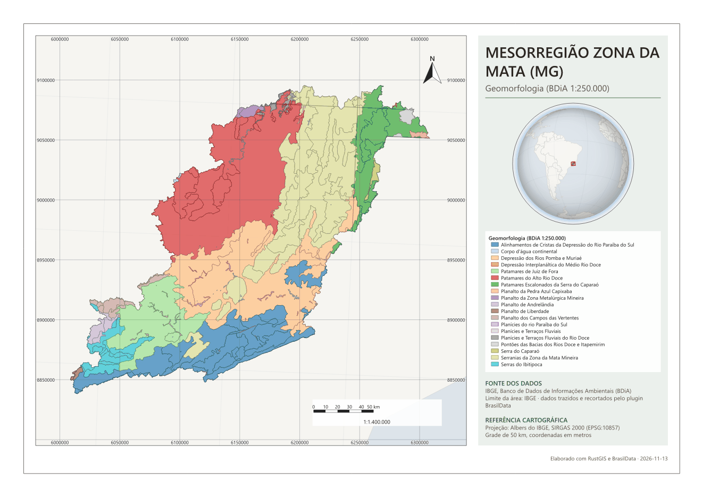

# Geomorfologia (BDiA 1:250.000)

<!-- Gerado por scripts/gerar.py a partir do fontes.csv e do fichas.csv; não edite à mão. -->

As unidades geomorfológicas: domínios, regiões e unidades do relevo, com a forma, a densidade de drenagem e o aprofundamento das incisões.

*Mapa exemplo: Zona da Mata (MG), feito com o plugin.*

| | |
|---|---|
| **Onde na aba** | Meio físico › Relevo |
| **Fonte** | IBGE |
| **Período** | mapeamento do Projeto RADAMBRASIL revisto pelo IBGE (anos 1970 a 2010), publicado no BDiA. |
| **Resolução ou escala** | escala 1:250.000 (área mínima mapeável de cerca de 2,5 km²). |
| **Unidades** | sem unidade; área do polígono em km² |
| **Legenda** | Polígonos por unidade (nm_unidade), com o domínio (nm_dominio), a região (nm_regiao) e o código do modelado (letra_simb: D, dissecação; A, acumulação; P, aplanamento...). |
| **Cuidados de uso** | Escala regional: não substitui um levantamento detalhado da propriedade (1:10.000 a 1:50.000). Cada polígono é uma unidade de mapeamento, que pode ter inclusões de outras classes. |
| **Licença** | uso livre com citação da fonte |
| **Citação** | IBGE, Banco de Dados de Informações Ambientais (BDiA). |
| **App desktop** | sim |
| **App web** | sim |

[Todas as camadas](README.md)
