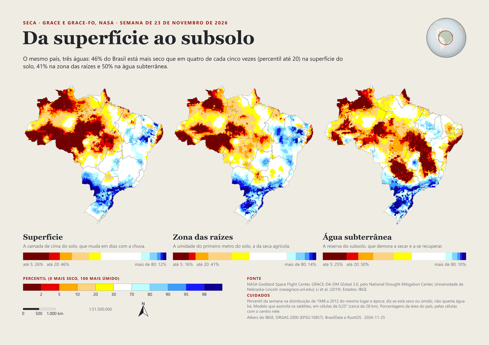

# Seca: umidade do solo e água subterrânea (GRACE, NASA)

<!-- Gerado por scripts/gerar.py a partir do fontes.csv e do fichas.csv; não edite à mão. -->

Os indicadores semanais de seca do GRACE (NASA): o percentil da umidade do primeiro metro do solo, da água subterrânea ou da umidade da superfície, de um modelo que assimila as medidas de gravidade dos satélites GRACE e GRACE-FO.

*Mapa exemplo: Brasil, com o dado do plugin e a folha feita à parte no RustGIS.*

| | |
|---|---|
| **Onde na aba** | Tempo e clima › Clima |
| **Fonte** | NASA Goddard Space Flight Center (pela Universidade de Nebraska-Lincoln). |
| **Período** | semanal (toda segunda-feira), de 03/02/2003 à semana mais recente; faltam duas semanas (24/05/2021 e 17/07/2023). |
| **Resolução ou escala** | 0,25° (cerca de 28 km) |
| **Unidades** | percentil (0 a 100) da semana na distribuição de 1948 a 2012 do mesmo lugar e época. |
| **Legenda** | Onze classes, nas cores do mapa da NASA: do vinho (até 2, o mais seco) ao amarelo (até 30), branco de 30 a 70, e do azul-claro ao azul-escuro (mais de 98, o mais úmido). |
| **Cuidados de uso** | Diz se está seco ou úmido para aquele lugar e época, não a quantidade de água. Para o país, o estado ou a bacia: um município tem uma ou poucas células. É um modelo com as medidas do GRACE (que sozinhas têm centenas de quilômetros), não uma medida de campo; não foi comparado com poços nem com medidas de solo pelo BrasilData. De 2017 a 2018 não houve satélite, e o modelo seguiu sem ele. A camada é mascarada pelo contorno, sem recorte. |
| **Licença** | CC BY 4.0 no registro de dados abertos da AWS; o GES DISC da NASA o diz aberto e sem restrição, com a citação. |
| **Citação** | NASA GSFC, GRACE-DA-DM Global 3.0, pelo National Drought Mitigation Center (nasagrace.unl.edu); Li, B. et al. (2019), Water Resources Research 55, 7564–7586, doi:10.1029/2018WR024618. |
| **App desktop** | sim |
| **App web** | não (o servidor não libera a leitura pelo navegador). |

[Todas as camadas](README.md)
