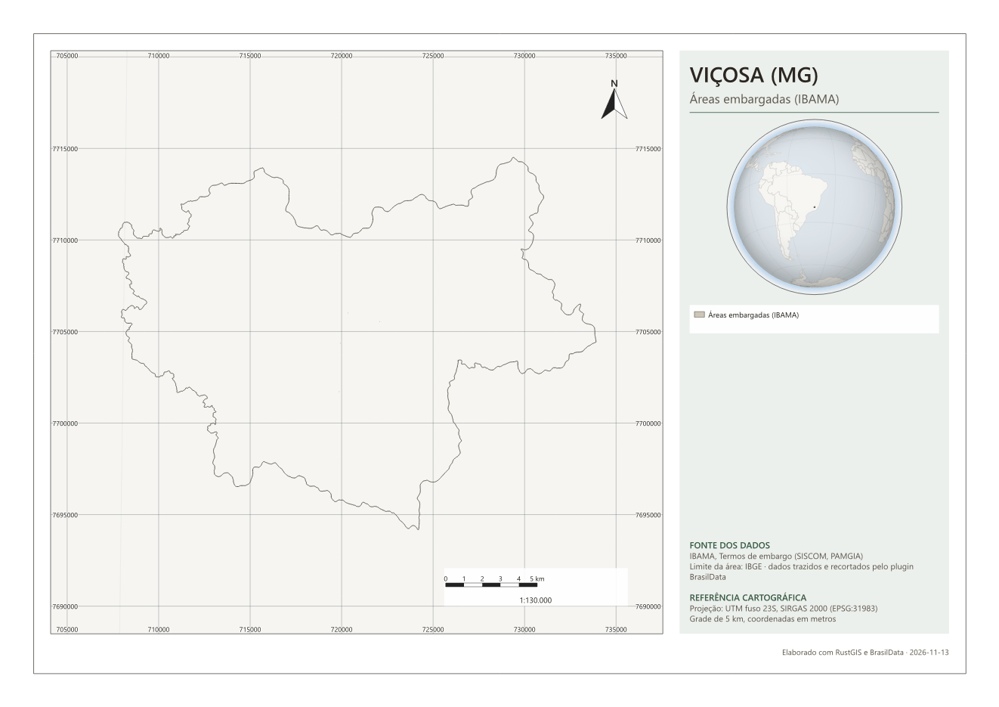

# Áreas embargadas (IBAMA)

<!-- Gerado por scripts/gerar.py a partir do fontes.csv e do fichas.csv; não edite à mão. -->

As áreas embargadas pelo IBAMA por infração ambiental (desmatamento ilegal, queimada...).

*Mapa exemplo: Viçosa (MG), feito com o plugin.*

| | |
|---|---|
| **Onde na aba** | Vegetação e meio ambiente › Fiscalização |
| **Fonte** | IBAMA |
| **Período** | termos de embargo desde os anos 2000 até a data do pedido. |
| **Resolução ou escala** | polígonos do auto de infração |
| **Unidades** | área embargada em ha |
| **Legenda** | Polígonos com a data do embargo, a infração, o bioma e a situação do desmatamento. |
| **Cuidados de uso** | Inclui embargos já resolvidos ou contestados; a situação jurídica se confere no IBAMA. Só os embargos federais. |
| **Licença** | dados abertos; licença não declarada no serviço. |
| **Citação** | IBAMA, Termos de embargo (SISCOM, PAMGIA). |
| **App desktop** | sim |
| **App web** | sim |

[Todas as camadas](README.md)
