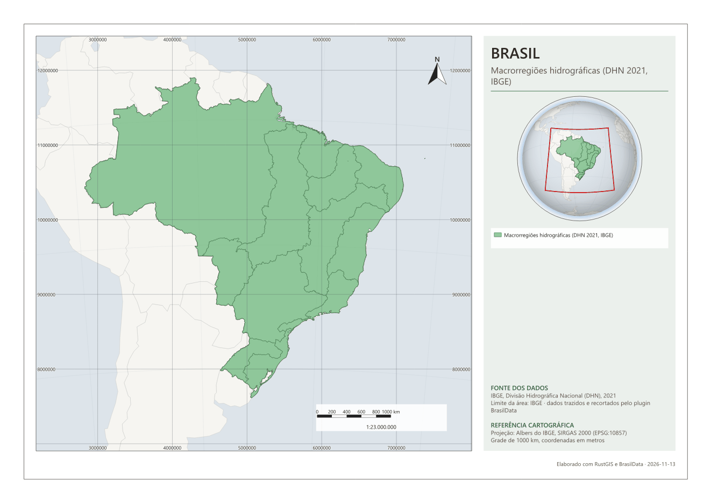

# Macrorregiões hidrográficas (DHN 2021, IBGE)

<!-- Gerado por scripts/gerar.py a partir do fontes.csv e do fichas.csv; não edite à mão. -->

As macrorregiões hidrográficas da Divisão Hidrográfica Nacional do IBGE (o primeiro nível, como Atlântico Sudeste).

*Mapa exemplo: Brasil, feito com o plugin.*

| | |
|---|---|
| **Onde na aba** | Água › Bacias |
| **Fonte** | IBGE |
| **Período** | Divisão Hidrográfica Nacional do IBGE, 2021. |
| **Resolução ou escala** | escala 1:250.000 |
| **Unidades** | sem unidade |
| **Legenda** | Polígonos com o código e o nome (cd_macrorh, nm_macrorh). |
| **Cuidados de uso** | Limites para mapas e estatística, não para demarcação legal. Vem o polígono inteiro de cada unidade que cruza a área, sem recorte. |
| **Licença** | uso livre com citação da fonte |
| **Citação** | IBGE, Divisão Hidrográfica Nacional (DHN), 2021. |
| **App desktop** | sim |
| **App web** | sim |

[Todas as camadas](README.md)
