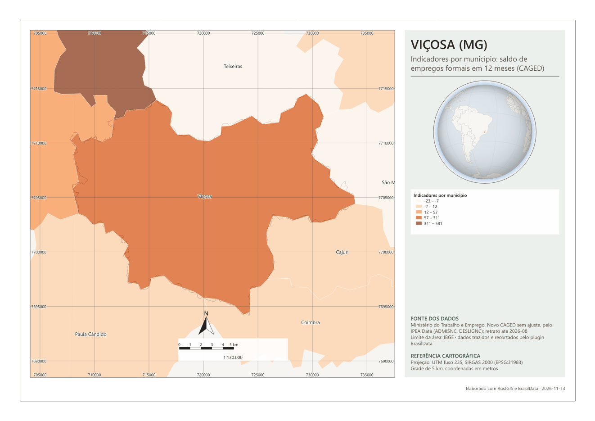

# Emprego formal (Novo CAGED)

<!-- Gerado por scripts/gerar.py a partir do fontes.csv e do fichas.csv; não edite à mão. -->

O emprego formal do Novo CAGED por município: admissões, desligamentos e saldo nos últimos 12 meses e o saldo do último mês.

*Mapa exemplo: Viçosa (MG), feito com o plugin.*

| | |
|---|---|
| **Onde na aba** | Sociedade e economia › Economia |
| **Fonte** | Ministério do Trabalho (pelo IPEA Data) |
| **Período** | os 12 meses até o último mês do retrato que vem com o plugin. |
| **Resolução ou escala** | município |
| **Unidades** | número de vínculos de emprego |
| **Legenda** | Na camada Indicadores por município, os municípios que cruzam a área (até 50); o layout faz um mapa coroplético. Os dados vêm num retrato guardado no plugin. |
| **Cuidados de uso** | Só o emprego com carteira assinada; a informalidade não aparece. |
| **Licença** | dados abertos; licença do IPEA Data não declarada. |
| **Citação** | Ministério do Trabalho e Emprego, Novo CAGED, pelo IPEA Data. |
| **App desktop** | sim |
| **App web** | sim |

[Todas as camadas](README.md)
