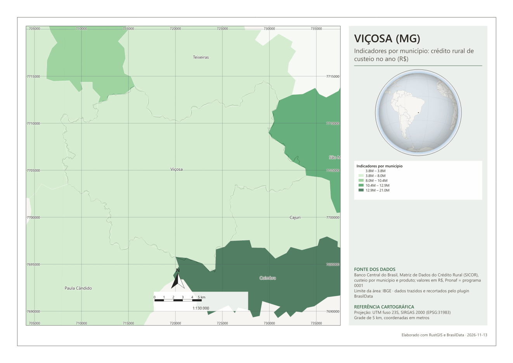

# Crédito rural de custeio (Banco Central)

<!-- Gerado por scripts/gerar.py a partir do fontes.csv e do fichas.csv; não edite à mão. -->

O crédito rural de custeio do último ano completo por município, do SICOR: total, Pronaf, agrícola, pecuário e área financiada.

*Mapa exemplo: Viçosa (MG), feito com o plugin.*

| | |
|---|---|
| **Onde na aba** | Sociedade e economia › Agricultura |
| **Fonte** | Banco Central (SICOR) |
| **Período** | o último ano completo |
| **Resolução ou escala** | município |
| **Unidades** | R$; ha |
| **Legenda** | Na camada Indicadores por município, os municípios que cruzam a área (até 200, mostrados só dentro dela); o layout faz um mapa coroplético. O SICOR é lento: cerca de 10 s para cada 6 municípios. |
| **Cuidados de uso** | Pelo município do empreendimento financiado; não inclui investimento nem comercialização. |
| **Licença** | ODbL (dados abertos do Banco Central) |
| **Citação** | Banco Central do Brasil, Matriz de Dados do Crédito Rural (SICOR), dados abertos. |
| **App desktop** | sim |
| **App web** | sim |

[Todas as camadas](README.md)
