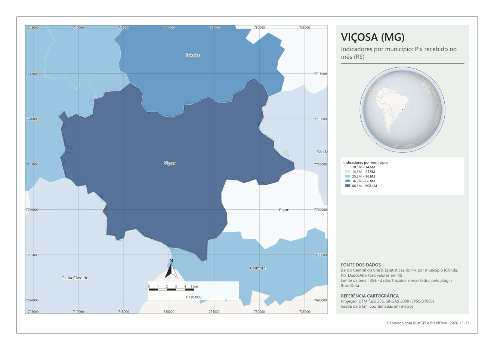

# Pix (Banco Central)

<!-- Gerado por scripts/gerar.py a partir do fontes.csv e do fichas.csv; não edite à mão. -->

O Pix do último mês completo por município: valor pago e recebido, transações e pessoas físicas pagadoras.

*Mapa exemplo: Viçosa (MG), feito com o plugin.*

| | |
|---|---|
| **Onde na aba** | Sociedade e economia › Economia |
| **Fonte** | Banco Central |
| **Período** | o último mês completo publicado |
| **Resolução ou escala** | município |
| **Unidades** | R$; número de transações; número de pessoas. |
| **Legenda** | Na camada Indicadores por município, os municípios que cruzam a área (até 50); o layout faz um mapa coroplético. |
| **Cuidados de uso** | Pelo município do cadastro do usuário no banco, não pelo lugar da compra. |
| **Licença** | ODbL (dados abertos do Banco Central) |
| **Citação** | Banco Central do Brasil, estatísticas do Pix por município (dados abertos). |
| **App desktop** | sim |
| **App web** | sim |

[Todas as camadas](README.md)
