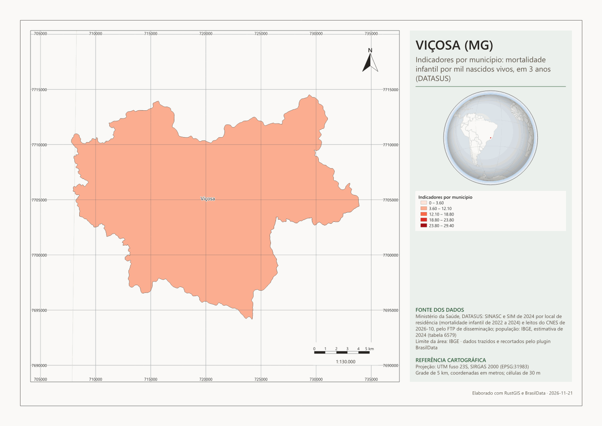

# Indicadores de saúde (DATASUS)

<!-- Gerado por scripts/gerar.py a partir do fontes.csv e do fichas.csv; não edite à mão. -->

Indicadores de saúde por município, do DATASUS: nascidos vivos e as condições do nascimento (SINASC), óbitos e as causas (SIM), mortalidade infantil e leitos (CNES), por local de residência.

*Mapa exemplo: Viçosa (MG), feito com o plugin.*

| | |
|---|---|
| **Onde na aba** | Sociedade e economia › Saúde |
| **Fonte** | Ministério da Saúde (DATASUS); IBGE |
| **Período** | o último ano fechado do SIM e do SINASC (a mortalidade infantil soma os 3 últimos anos); os leitos, o último mês do CNES. |
| **Resolução ou escala** | município |
| **Unidades** | número de nascidos e de óbitos; % dos nascidos ou dos óbitos com a informação preenchida; óbitos por mil habitantes; óbitos de menores de 1 ano por mil nascidos vivos; leitos e leitos do SUS por mil habitantes. |
| **Legenda** | Na camada Indicadores por município, os municípios que cruzam a área (até 200, mostrados só dentro dela); o layout faz um mapa coroplético da mortalidade infantil. Os dados vêm num retrato guardado no plugin. Campos: saude_nascidos, saude_baixo_peso_pct, saude_cesarea_pct, saude_mae_adolescente_pct, saude_prenatal7_pct, saude_obitos, saude_mortalidade_mil, saude_mort_infantil, saude_externas_pct, saude_circulatorio_pct, saude_neoplasias_pct, saude_respiratorio_pct, saude_leitos, saude_leitos_sus, saude_leitos_sus_mil, saude_populacao. |
| **Cuidados de uso** | Num município pequeno, poucos casos mudam muito as taxas: compare a mortalidade infantil com a da microrregião. O SIM e o SINASC subnotificam em parte do Norte e do Nordeste. Os leitos contam onde ficam, não onde mora quem os usa: uma cidade-polo tem mais leitos por habitante. As partes são das declarações com a informação preenchida. |
| **Licença** | dados abertos do Ministério da Saúde e do IBGE, com citação da fonte. |
| **Citação** | Ministério da Saúde, DATASUS: Sistema de Informações sobre Mortalidade (SIM), Sistema de Informações sobre Nascidos Vivos (SINASC) e Cadastro Nacional de Estabelecimentos de Saúde (CNES), pelo FTP de disseminação; IBGE, estimativas da população (tabela 6579). |
| **App desktop** | sim |
| **App web** | sim |

[Todas as camadas](README.md)
