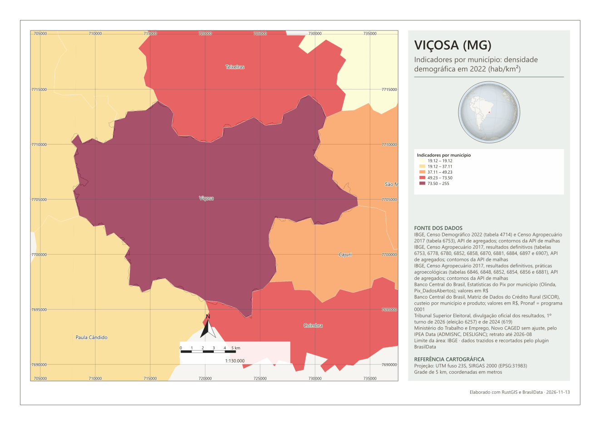

# Todos os indicadores

<!-- Gerado por scripts/gerar.py a partir do fontes.csv e do fichas.csv; não edite à mão. -->

Todos os indicadores por município de uma vez: censos, Censo Agropecuário, agroecologia, Pix, crédito rural, eleições e emprego formal.

*Mapa exemplo: Viçosa (MG), feito com o plugin.*

| | |
|---|---|
| **Onde na aba** | Sociedade e economia |
| **Fonte** | IBGE, Banco Central, TSE e Ministério do Trabalho. |
| **Período** | o de cada fonte |
| **Resolução ou escala** | município |
| **Unidades** | as de cada fonte |
| **Legenda** | Na camada Indicadores por município, os municípios que cruzam a área (até 50); o layout faz um mapa coroplético. No desktop, se o tempo acabar, um novo clique continua de onde parou. |
| **Cuidados de uso** | Os de cada fonte (veja a ficha de cada uma). |
| **Licença** | a de cada fonte |
| **Citação** | IBGE (SIDRA), Banco Central (Pix e SICOR), TSE e Novo CAGED (IPEA Data): a citação de cada fonte vai na tabela Fontes. |
| **App desktop** | sim |
| **App web** | sim |

[Todas as camadas](README.md)
