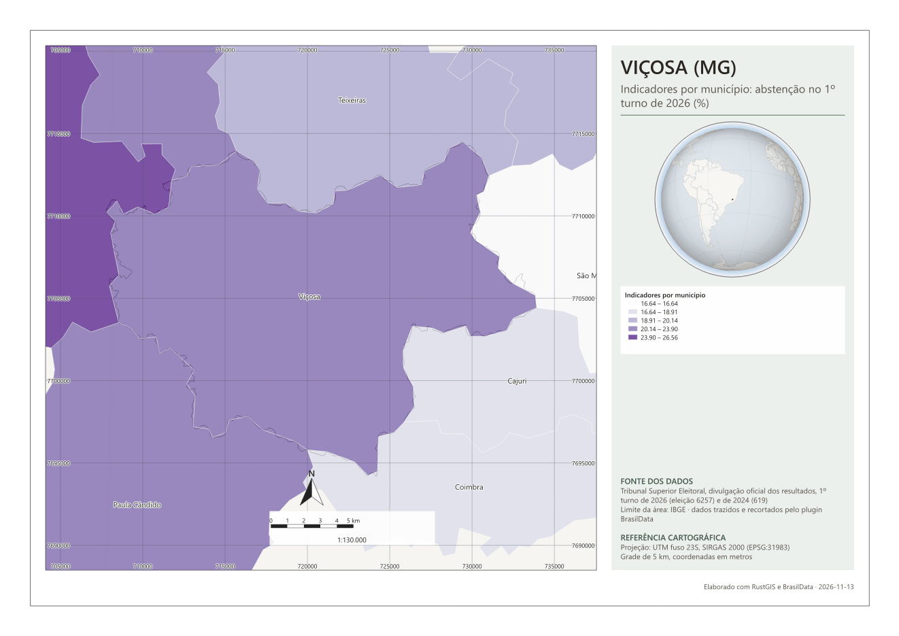

# Eleitorado e comparecimento (TSE)

<!-- Gerado por scripts/gerar.py a partir do fontes.csv e do fichas.csv; não edite à mão. -->

O eleitorado, o comparecimento e a abstenção no 1º turno de 2026 e de 2024 por município.

*Mapa exemplo: Viçosa (MG), feito com o plugin.*

| | |
|---|---|
| **Onde na aba** | Sociedade e economia › Eleições |
| **Fonte** | TSE |
| **Período** | 1º turno de 2024 (municipal) e de 2026 (geral). |
| **Resolução ou escala** | município |
| **Unidades** | eleitores; % de comparecimento e de abstenção. |
| **Legenda** | Na camada Indicadores por município, os municípios que cruzam a área (até 200, mostrados só dentro dela); o layout faz um mapa coroplético. |
| **Cuidados de uso** | Eleitorado de domicílio eleitoral, que pode diferir da população residente. |
| **Licença** | CC BY (dados abertos do TSE) |
| **Citação** | Tribunal Superior Eleitoral, resultados oficiais de comparecimento e abstenção (dados abertos). |
| **App desktop** | sim |
| **App web** | sim |

[Todas as camadas](README.md)
