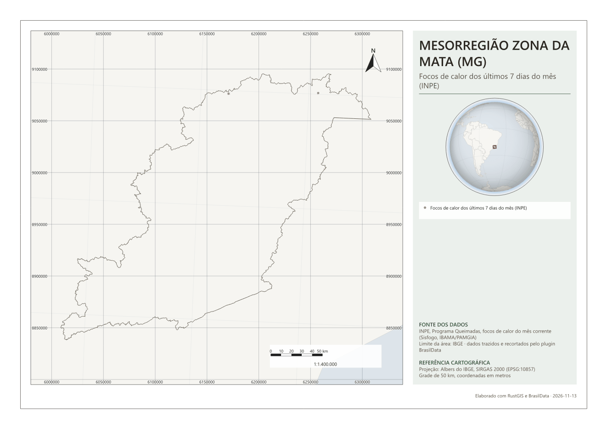

# Focos de calor dos últimos 7 dias do mês (INPE)

<!-- Gerado por scripts/gerar.py a partir do fontes.csv e do fichas.csv; não edite à mão. -->

Os focos de calor dos últimos 7 dias (Programa Queimadas do INPE).

*Mapa exemplo: Zona da Mata (MG), feito com o plugin.*

| | |
|---|---|
| **Onde na aba** | Vegetação e meio ambiente › Queimadas |
| **Fonte** | INPE |
| **Período** | os últimos 7 dias, dentro do mês corrente. |
| **Resolução ou escala** | pontos (o centro do pixel do satélite: 375 m a 4 km, conforme o sensor). |
| **Unidades** | sem unidade (cada ponto é um foco); data e hora em UTC. |
| **Legenda** | Pontos com a data e a hora, o satélite, o bioma e o município. |
| **Cuidados de uso** | Um foco é um pixel quente, não um incêndio: um fogo grande dá vários focos, e um pequeno ou sob nuvem pode não aparecer. A posição tem erro de até centenas de metros. |
| **Licença** | dados abertos; licença não declarada no serviço. |
| **Citação** | INPE, Programa Queimadas, focos de calor do mês corrente (Sisfogo, IBAMA/PAMGIA). |
| **App desktop** | sim |
| **App web** | sim |

[Todas as camadas](README.md)
