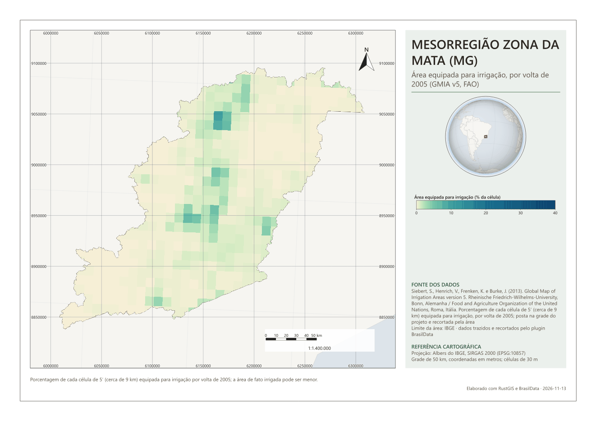

# Área equipada para irrigação (GMIA v5, FAO)

<!-- Gerado por scripts/gerar.py a partir do fontes.csv e do fichas.csv; não edite à mão. -->

A porcentagem de cada célula equipada para irrigação, do Global Map of Irrigation Areas versão 5 (FAO e Universidade de Bonn).

*Mapa exemplo: Zona da Mata (MG), feito com o plugin.*

| | |
|---|---|
| **Onde na aba** | Água › Recursos hídricos |
| **Fonte** | FAO e Universidade de Bonn |
| **Período** | por volta de 2005 |
| **Resolução ou escala** | 5′ (cerca de 9 km) |
| **Unidades** | % da área da célula |
| **Legenda** | Escala contínua de 0 ao máximo na área. |
| **Cuidados de uso** | Área equipada, não necessariamente irrigada; dado antigo e grosso: para municípios, o Censo Agropecuário 2017. |
| **Licença** | CC BY 4.0 (FAO) |
| **Citação** | Siebert et al. (2013), Global Map of Irrigation Areas version 5, Universidade de Bonn e FAO. |
| **App desktop** | sim |
| **App web** | a confirmar |

[Todas as camadas](README.md)
