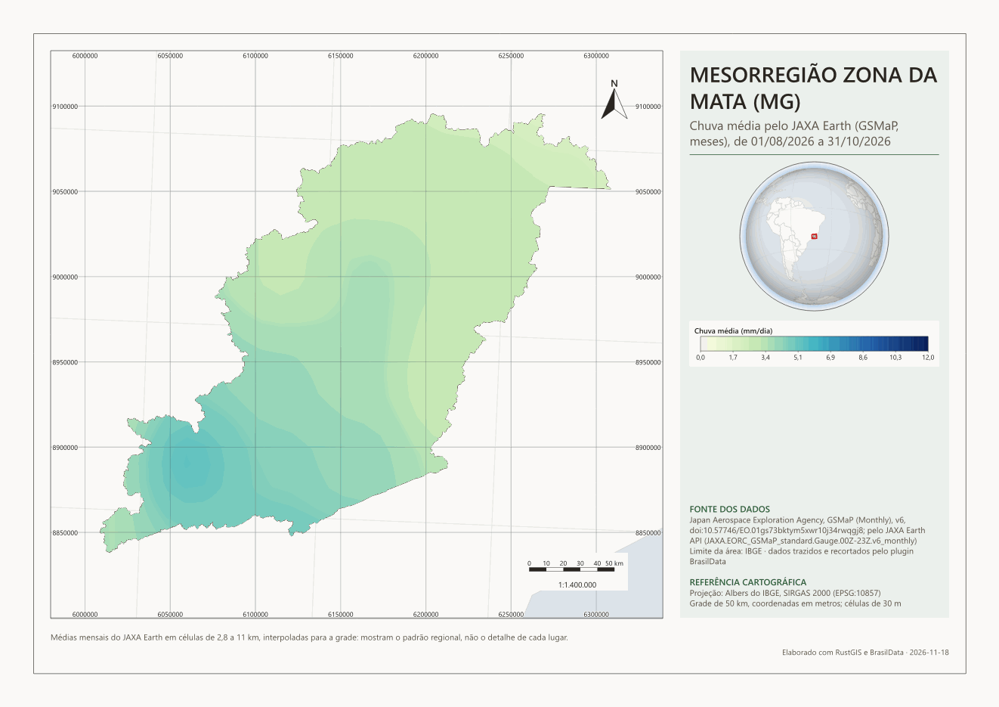

# Chuva por satélite (GSMaP, JAXA)

<!-- Gerado por scripts/gerar.py a partir do fontes.csv e do fichas.csv; não edite à mão. -->

A chuva estimada por satélite do GSMaP, ajustada com pluviômetros, em mm por dia, resumida nos meses do período.

*Mapa exemplo: Zona da Mata (MG), feito com o plugin.*

| | |
|---|---|
| **Onde na aba** | Tempo e clima › Satélites do JAXA |
| **Fonte** | JAXA (agência espacial do Japão) |
| **Período** | desde março de 2000, por mês |
| **Resolução ou escala** | 0,1° (cerca de 11 km) |
| **Unidades** | mm por dia |
| **Legenda** | Escala do branco ao azul, de 0 a 12 mm por dia. |
| **Cuidados de uso** | Estimativa por satélite: a chuva forte e localizada (temporais) fica diluída na célula de 11 km; num município pequeno o mapa tem poucas células. |
| **Licença** | termos do JAXA Earth: uso livre, com o crédito "JAXA" e o nome do conjunto; uso comercial, avisando a JAXA antes. |
| **Citação** | Japan Aerospace Exploration Agency, GSMaP (Monthly), v6, doi:10.57746/EO.01gs73bktym5xwr10j34rwqgj8, pelo JAXA Earth API. |
| **App desktop** | sim |
| **App web** | não: só no desktop (o resumo do cubo, cube.reduce, lê o STAC no desktop). |

[Todas as camadas](README.md)
