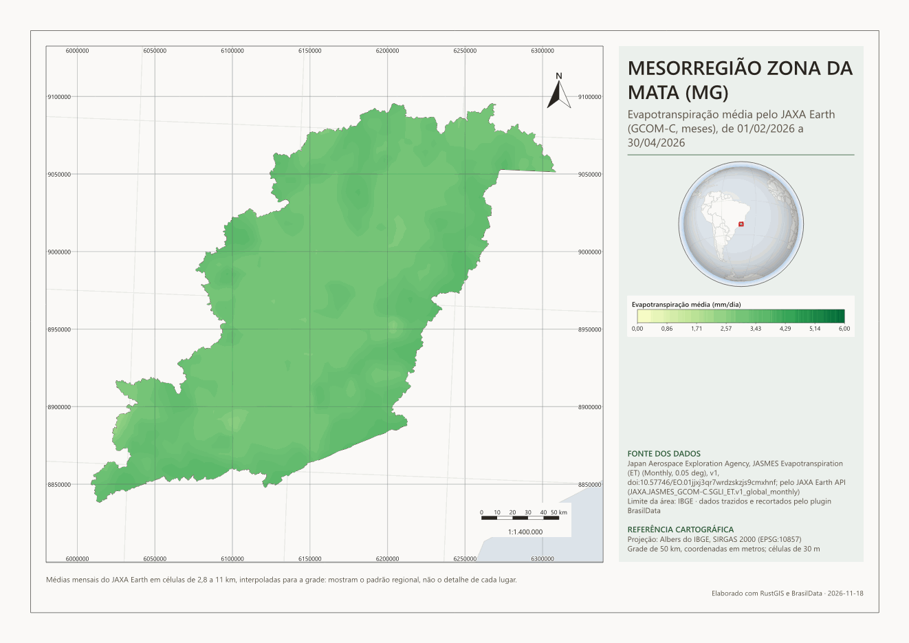

# Evapotranspiração (GCOM-C, JAXA)

<!-- Gerado por scripts/gerar.py a partir do fontes.csv e do fichas.csv; não edite à mão. -->

A evapotranspiração (a água que o solo e as plantas devolvem ao ar), do JASMES com o sensor SGLI (GCOM-C), resumida nos meses do período.

*Mapa exemplo: Zona da Mata (MG), feito com o plugin.*

| | |
|---|---|
| **Onde na aba** | Tempo e clima › Satélites do JAXA |
| **Fonte** | JAXA (agência espacial do Japão) |
| **Período** | desde abril de 2025, por mês |
| **Resolução ou escala** | 0,05° (cerca de 5,5 km) |
| **Unidades** | mm por dia |
| **Legenda** | Escala do amarelo ao verde, de 0 a 6 mm por dia. |
| **Cuidados de uso** | Estimada por um modelo com dados de satélite; os meses antes de abril de 2025 não estão no STAC do JAXA Earth. |
| **Licença** | termos do JAXA Earth: uso livre, com o crédito "JAXA" e o nome do conjunto; uso comercial, avisando a JAXA antes. |
| **Citação** | Japan Aerospace Exploration Agency, JASMES Evapotranspiration (ET) (Monthly, 0.05 deg), v1, doi:10.57746/EO.01jjxj3qr7wrdzskzjs9cmxhnf, pelo JAXA Earth API. |
| **App desktop** | sim |
| **App web** | não: só no desktop (o resumo do cubo, cube.reduce, lê o STAC no desktop). |

[Todas as camadas](README.md)
