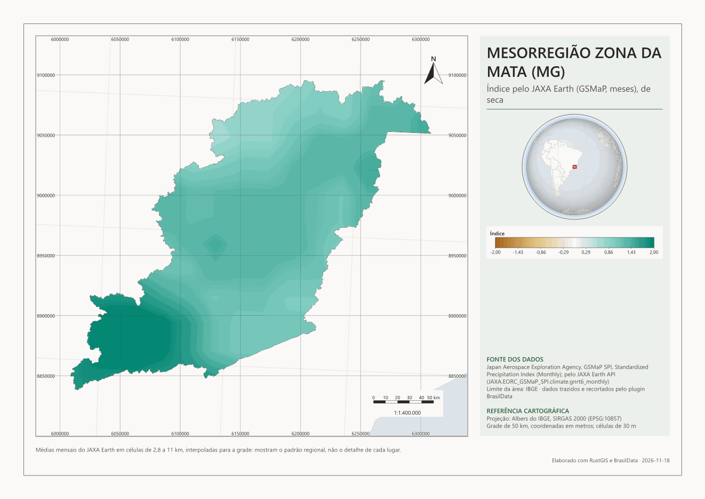

# Índice de seca SPI (GSMaP, JAXA)

<!-- Gerado por scripts/gerar.py a partir do fontes.csv e do fichas.csv; não edite à mão. -->

O índice de precipitação padronizado (SPI) do GSMaP: quanto a chuva do mês fugiu da normal, em desvios-padrão, resumido nos meses do período.

*Mapa exemplo: Zona da Mata (MG), feito com o plugin.*

| | |
|---|---|
| **Onde na aba** | Tempo e clima › Satélites do JAXA |
| **Fonte** | JAXA (agência espacial do Japão) |
| **Período** | desde junho de 2019, por mês |
| **Resolução ou escala** | cerca de 22 km |
| **Unidades** | desvios-padrão (sem unidade) |
| **Legenda** | Escala do marrom (seca, -2) ao verde (chuva acima do normal, +2). |
| **Cuidados de uso** | Abaixo de -1 é seca; abaixo de -2, seca extrema. A normal é a do próprio GSMaP. Num município pequeno, o mapa tem uma ou duas células. |
| **Licença** | termos do JAXA Earth: uso livre, com o crédito "JAXA" e o nome do conjunto; uso comercial, avisando a JAXA antes. |
| **Citação** | Japan Aerospace Exploration Agency, GSMaP SPI, Standardized Precipitation Index (Monthly), pelo JAXA Earth API. |
| **App desktop** | sim |
| **App web** | não: só no desktop (o resumo do cubo, cube.reduce, lê o STAC no desktop). |

[Todas as camadas](README.md)
