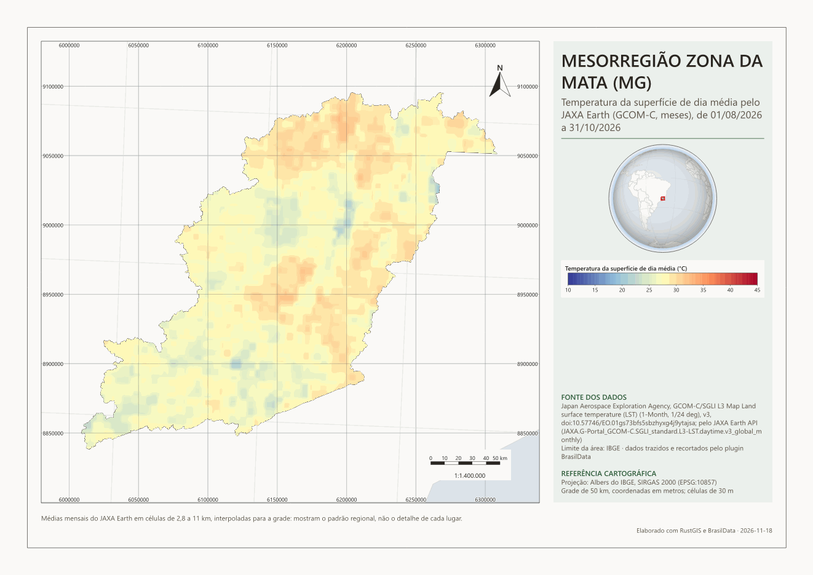

# Temperatura da superfície (GCOM-C, JAXA)

<!-- Gerado por scripts/gerar.py a partir do fontes.csv e do fichas.csv; não edite à mão. -->

A temperatura da superfície da terra, do sensor SGLI (GCOM-C), de dia ou à noite, resumida nos meses do período.

*Mapa exemplo: Zona da Mata (MG), feito com o plugin.*

| | |
|---|---|
| **Onde na aba** | Tempo e clima › Satélites do JAXA |
| **Fonte** | JAXA (agência espacial do Japão) |
| **Período** | desde 2018, por mês |
| **Resolução ou escala** | 1/24° (cerca de 4,6 km) |
| **Unidades** | °C |
| **Legenda** | Escala do azul ao vermelho, de 10 a 45 °C. |
| **Cuidados de uso** | É a temperatura da superfície (solo, telhado, copa), não a do ar: de dia passa da do ar em vários graus. Meses nublados têm menos observações. |
| **Licença** | termos do JAXA Earth: uso livre, com o crédito "JAXA" e o nome do conjunto; uso comercial, avisando a JAXA antes. |
| **Citação** | Japan Aerospace Exploration Agency, GCOM-C/SGLI L3 Map Land surface temperature (LST) (1-Month, 1/24 deg), v3, doi:10.57746/EO.01gs73bfs5sbzhyxg4j9ytajsa, pelo JAXA Earth API. |
| **App desktop** | sim |
| **App web** | não: só no desktop (o resumo do cubo, cube.reduce, lê o STAC no desktop). |

[Todas as camadas](README.md)
