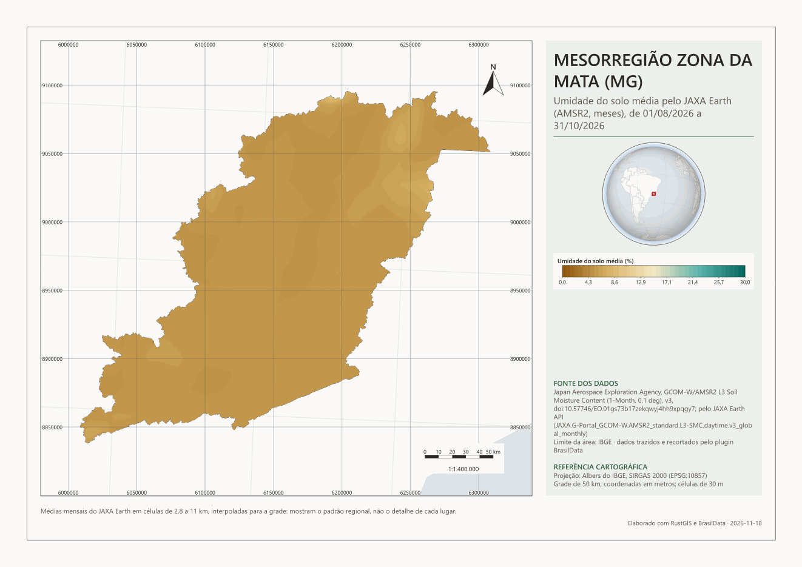

# Umidade do solo (AMSR2, JAXA)

<!-- Gerado por scripts/gerar.py a partir do fontes.csv e do fichas.csv; não edite à mão. -->

A umidade da camada de cima do solo, do radiômetro de micro-ondas AMSR2 (GCOM-W), resumida nos meses do período.

*Mapa exemplo: Zona da Mata (MG), feito com o plugin.*

| | |
|---|---|
| **Onde na aba** | Tempo e clima › Satélites do JAXA |
| **Fonte** | JAXA (agência espacial do Japão) |
| **Período** | desde julho de 2012, por mês |
| **Resolução ou escala** | 0,1° (cerca de 11 km) |
| **Unidades** | % (volume de água no solo) |
| **Legenda** | Escala do marrom (seco) ao verde-azulado (úmido), de 0 a 30 %. |
| **Cuidados de uso** | Lê só os primeiros centímetros; subestima sob floresta densa e exagera perto de rios e do mar. Use como padrão relativo. |
| **Licença** | termos do JAXA Earth: uso livre, com o crédito "JAXA" e o nome do conjunto; uso comercial, avisando a JAXA antes. |
| **Citação** | Japan Aerospace Exploration Agency, GCOM-W/AMSR2 L3 Soil Moisture Content (1-Month, 0.1 deg), v3, doi:10.57746/EO.01gs73b17zekqwyj4hh9xpqgy7, pelo JAXA Earth API. |
| **App desktop** | sim |
| **App web** | não: só no desktop (o resumo do cubo, cube.reduce, lê o STAC no desktop). |

[Todas as camadas](README.md)
