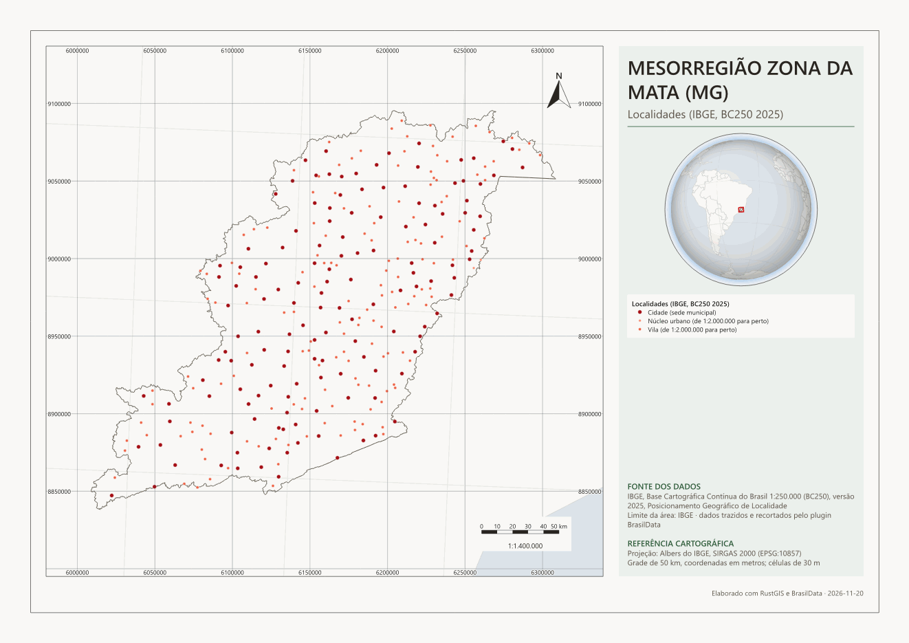

# Localidades (IBGE, BC250 2025)

<!-- Gerado por scripts/gerar.py a partir do fontes.csv e do fichas.csv; não edite à mão. -->

O ponto de cada localidade da Base Cartográfica Contínua do IBGE: cidades (as sedes municipais), vilas (as sedes de distrito), núcleos urbanos e aglomerados rurais, com o nome e o tipo.

*Mapa exemplo: Zona da Mata (MG), feito com o plugin.*

| | |
|---|---|
| **Onde na aba** | Território › Limites |
| **Fonte** | IBGE |
| **Período** | BC250, versão 2025 |
| **Resolução ou escala** | escala 1:250.000 (um ponto por localidade). |
| **Unidades** | sem unidade (pontos) |
| **Legenda** | Uma cor por tipo de localidade (campo tipolocalidade), cada tipo a partir de uma escala da vista: as cidades sempre; as vilas e os núcleos urbanos de 1:2.000.000 para perto; os aglomerados rurais de 1:500.000 para perto. |
| **Cuidados de uso** | O ponto marca a localidade, não a área urbana dela (para o contorno, o tema Área urbana por município). Na escala 1:250.000, povoados e lugarejos pequenos podem faltar. |
| **Licença** | uso livre com citação da fonte |
| **Citação** | IBGE, Base Cartográfica Contínua do Brasil 1:250.000 (BC250), versão 2025, Posicionamento Geográfico de Localidade. |
| **App desktop** | sim |
| **App web** | sim |

[Todas as camadas](README.md)
