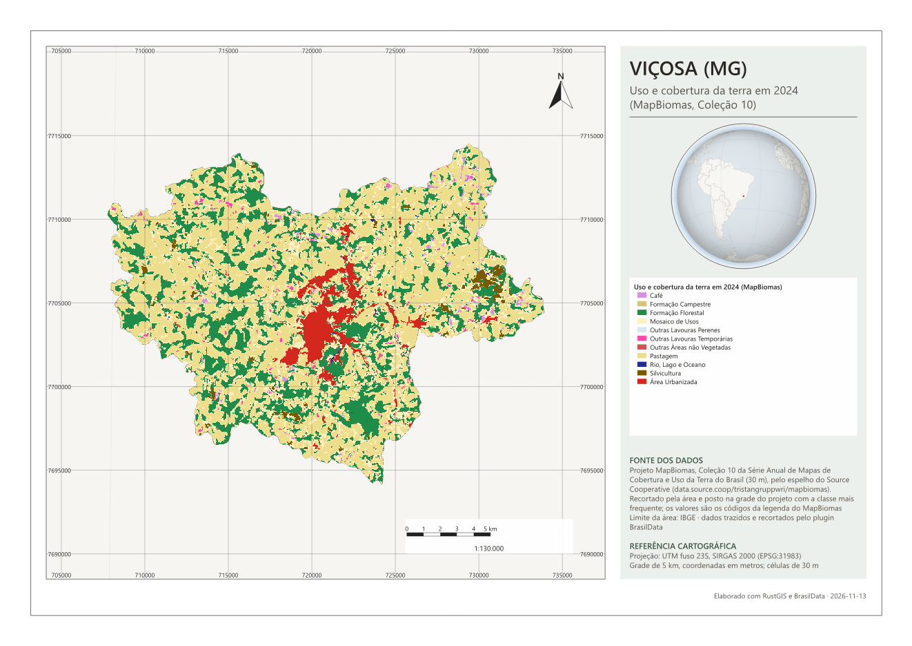

# Uso e cobertura (MapBiomas)

<!-- Gerado por scripts/gerar.py a partir do fontes.csv e do fichas.csv; não edite à mão. -->

O uso e a cobertura da terra do MapBiomas: floresta, savana, campo, pastagem, agricultura, silvicultura, área urbana, água...

*Mapa exemplo: Viçosa (MG), feito com o plugin.*

| | |
|---|---|
| **Onde na aba** | Vegetação e meio ambiente › Uso e cobertura. |
| **Fonte** | MapBiomas |
| **Período** | um ano de 1985 a 2025 (recortado pela área: 2019 a 2024). |
| **Resolução ou escala** | 30 m (Landsat) |
| **Unidades** | códigos da legenda do MapBiomas (valor do pixel). |
| **Legenda** | As classes da Coleção, nas cores da legenda oficial: 3 formação florestal, 4 savânica, 12 campestre, 15 pastagem, 39 soja, 21 mosaico de usos, 24 área urbana, 33 rio e lago... |
| **Cuidados de uso** | Mapeamento automático com acurácia de cerca de 90% no Brasil, menor em classes raras e em mosaicos de uso. Sem área, ou fora de 2019 a 2024, vem só o mapa para ver, não o raster. |
| **Licença** | CC BY 4.0, pelos termos do MapBiomas |
| **Citação** | Projeto MapBiomas, Coleção 10/11 da Série Anual de Mapas de Cobertura e Uso da Terra do Brasil. |
| **App desktop** | sim |
| **App web** | sim (o mapa para ver); o recorte pede a leitura da janela de um arquivo remoto. |

[Todas as camadas](README.md)
