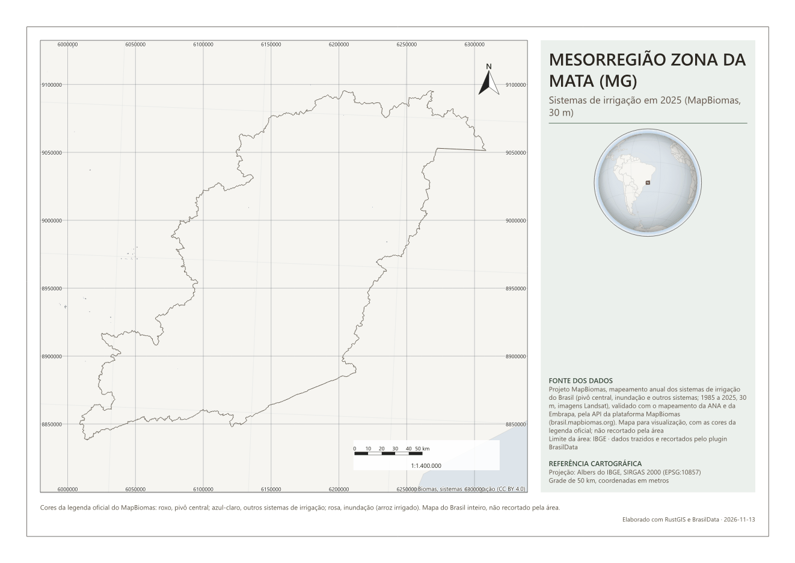

# Sistemas de irrigação (MapBiomas)

<!-- Gerado por scripts/gerar.py a partir do fontes.csv e do fichas.csv; não edite à mão. -->

Os sistemas de irrigação mapeados pelo MapBiomas: pivô central, inundação (arroz) e outros sistemas.

*Mapa exemplo: Zona da Mata (MG), feito com o plugin.*

| | |
|---|---|
| **Onde na aba** | Água › Recursos hídricos |
| **Fonte** | MapBiomas |
| **Período** | um ano de 1985 a 2025 |
| **Resolução ou escala** | 30 m (Landsat) |
| **Unidades** | classes (sem unidade) |
| **Legenda** | Pivô central em roxo, outros sistemas em azul-claro, inundação (arroz irrigado) em rosa. |
| **Cuidados de uso** | Mapa para ver, do Brasil inteiro, sem recorte; para números, a área equipada do GMIA ou os pivôs da ANA. |
| **Licença** | CC BY 4.0, pelos termos do MapBiomas |
| **Citação** | Projeto MapBiomas, mapeamento anual dos sistemas de irrigação do Brasil (1985 a 2025, 30 m). |
| **App desktop** | sim |
| **App web** | sim |

[Todas as camadas](README.md)
