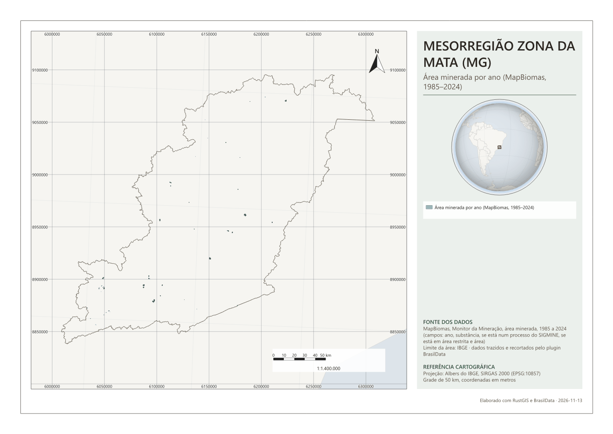

# Área minerada por ano (MapBiomas, 1985–2024)

<!-- Gerado por scripts/gerar.py a partir do fontes.csv e do fichas.csv; não edite à mão. -->

A área minerada mapeada pelo MapBiomas em imagens Landsat, com o ano em que a mineração apareceu.

*Mapa exemplo: Zona da Mata (MG), feito com o plugin.*

| | |
|---|---|
| **Onde na aba** | Meio físico › Geologia e recursos minerais. |
| **Fonte** | MapBiomas |
| **Período** | 1985 a 2024 |
| **Resolução ou escala** | 30 m (mapeado em imagens Landsat), entregue como polígonos. |
| **Unidades** | área em ha |
| **Legenda** | Polígonos pelo ano, com a substância, se estão num processo do SIGMINE e se estão em área restrita. |
| **Cuidados de uso** | Mapeamento automático: inclui garimpo e mineração industrial, e pode confundir solo exposto de outras origens. |
| **Licença** | CC BY 4.0, pelos termos do MapBiomas; não declarada no serviço. |
| **Citação** | MapBiomas, Monitor da Mineração, área minerada, 1985 a 2024 (campos: ano, substância, se está num processo do SIGMINE, se está em área restrita e área). |
| **App desktop** | sim |
| **App web** | sim |

[Todas as camadas](README.md)
