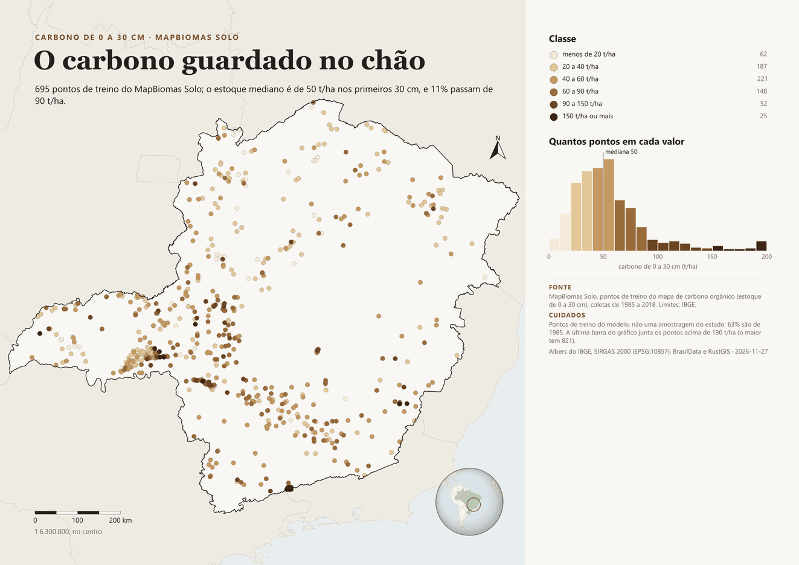

# Pontos de treino do MapBiomas Solo

<!-- Gerado por scripts/gerar.py a partir do fontes.csv e do fichas.csv; não edite à mão. -->

As amostras de solo com que o MapBiomas treinou os mapas da Coleção 3 (beta) do MapBiomas Solo, publicadas no SoilData: o estoque de carbono orgânico de 0 a 30 cm de cada coleta, de 1985 a 2024, e a argila, a areia, o silte e a fração grossa das camadas até 100 cm.

*Mapa exemplo: Minas Gerais, com o dado do plugin e a folha feita à parte no RustGIS.*

| | |
|---|---|
| **Onde na aba** | Meio físico › Solos |
| **Fonte** | MapBiomas (MapBiomas Solo, Coleção 3 beta), pelo SoilData. |
| **Período** | carbono: coletas de 1985 a 2024 (a maioria antes de 2000), uma por ponto, com o ano; textura: coletas de vários anos (campo ano_da_coleta). |
| **Resolução ou escala** | pontos: um perfil ou uma amostra, com as coordenadas do levantamento de origem. |
| **Unidades** | t/ha (estoque de carbono de 0 a 30 cm), g/kg (argila, areia, silte e fração grossa). |
| **Legenda** | Pontos coloridos em faixas. O carbono: o estoque de 0 a 30 cm (campo carbono_0_30_tha), de menos de 20 a 150 t/ha ou mais, com o ano da coleta (data_ano) e se a amostra é do Inventário Florestal Nacional (IFN_index). A textura: a camada que contém a profundidade escolhida (5, 10, 30, 50 ou 90 cm), a argila nos grupos de textura do SiBCS, com o conjunto de origem, a licença e o ano. |
| **Cuidados de uso** | São os dados de treino dos mapas, não os mapas: para o carbono ou a textura em cada lugar, use os mapas do MapBiomas Solo. O estoque é o de 0 a 30 cm de cada coleta, no ano dela: não compare pontos de anos distantes como se fossem do mesmo momento. As amostras do Inventário Florestal Nacional têm o estoque corrigido por quantis, como o MapBiomas fez. Ficam de fora as 3.000 pseudoamostras de rocha e de areia do modelo e os pontos só até 20 cm; 328 pontos do carbono têm a coordenada sem o ponto decimal no arquivo e saem no recorte. Muitas camadas de textura repetem as de Pontos de solo (SoilData), do mesmo repositório. Na textura, cada camada tem a licença do conjunto de origem, e cerca de 40% são CC BY-NC, sem uso comercial. |
| **Licença** | CC BY 4.0 (os conjuntos); na textura, cada camada com a licença do conjunto de origem (CC BY ou CC BY-NC, sem uso comercial). |
| **Citação** | MapBiomas, Training Field Soil Data for Annual Mapping of Soil Organic Carbon Stock (0–30 cm) in Brazil, 1985–2024, doi:10.60502/SoilData/IUZOAK; MapBiomas, Training Field Soil Data for Mapping of Soil Particle Size Distribution (0–100 cm) in Brazil, doi:10.60502/SoilData/OXSR2N (MapBiomas Soil Collection 3, Beta Version, SoilData). |
| **App desktop** | sim |
| **App web** | ainda não testado: o repositório libera a leitura pelo navegador. |

[Todas as camadas](README.md)
