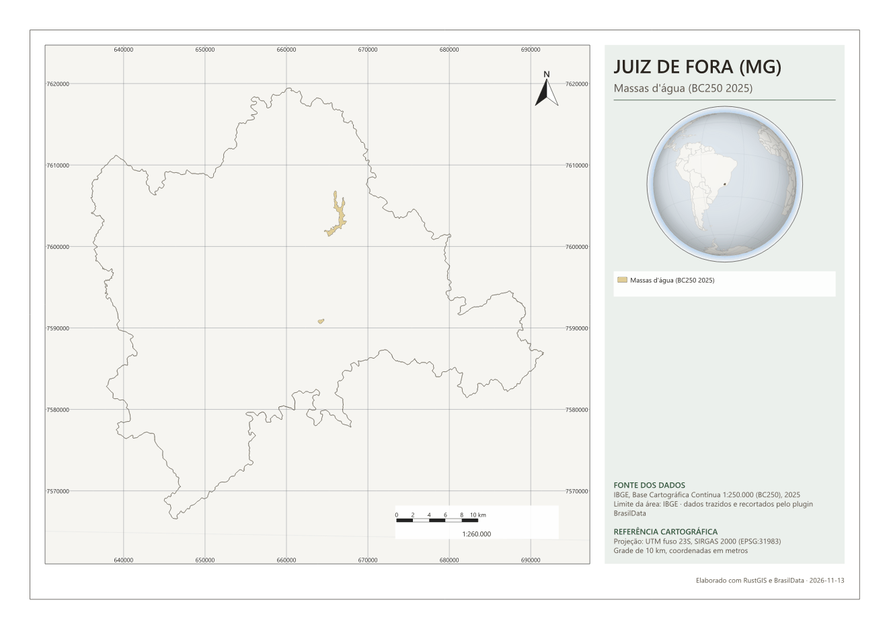

# Massas d'água (BC250 2025)

<!-- Gerado por scripts/gerar.py a partir do fontes.csv e do fichas.csv; não edite à mão. -->

Lagos, lagoas, represas e trechos largos de rio da Base Cartográfica Contínua do IBGE.

*Mapa exemplo: Juiz de Fora (MG), feito com o plugin.*

| | |
|---|---|
| **Onde na aba** | Água › Hidrografia |
| **Fonte** | IBGE |
| **Período** | BC250, edição 2025 |
| **Resolução ou escala** | escala 1:250.000 |
| **Unidades** | sem unidade |
| **Legenda** | Polígonos pelo tipo de massa d'água e pelo regime, com o nome. |
| **Cuidados de uso** | Massas d'água pequenas (menores que cerca de 0,6 km²) não aparecem na escala 1:250.000. |
| **Licença** | uso livre com citação da fonte |
| **Citação** | IBGE, Base Cartográfica Contínua 1:250.000 (BC250), 2025. |
| **App desktop** | sim |
| **App web** | sim |

[Todas as camadas](README.md)
