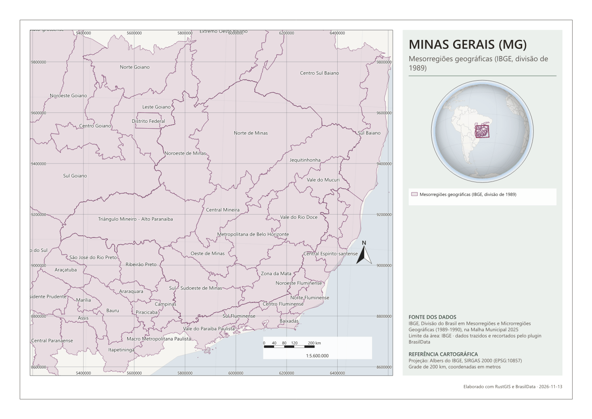

# Mesorregiões geográficas (IBGE, divisão de 1989)

<!-- Gerado por scripts/gerar.py a partir do fontes.csv e do fichas.csv; não edite à mão. -->

As mesorregiões geográficas da divisão de 1989 do IBGE (Zona da Mata, Triângulo Mineiro...).

*Mapa exemplo: Minas Gerais, feito com o plugin.*

| | |
|---|---|
| **Onde na aba** | Território › Limites |
| **Fonte** | IBGE |
| **Período** | divisão de 1989-1990, nos limites da Malha Municipal 2025. |
| **Resolução ou escala** | escala 1:250.000 |
| **Unidades** | sem unidade |
| **Legenda** | Um polígono por mesorregião, com o código e o nome (cd_meso, nm_meso). |
| **Cuidados de uso** | Limites para mapas e estatística, não para demarcação legal. Vem o polígono inteiro de cada unidade que cruza a área, sem recorte. Divisão antiga, que o IBGE trocou pelas regiões intermediárias em 2017; ainda usada em séries históricas. |
| **Licença** | uso livre com citação da fonte |
| **Citação** | IBGE, Divisão do Brasil em Mesorregiões e Microrregiões Geográficas (1989-1990), na Malha Municipal 2025. |
| **App desktop** | sim |
| **App web** | sim |

[Todas as camadas](README.md)
