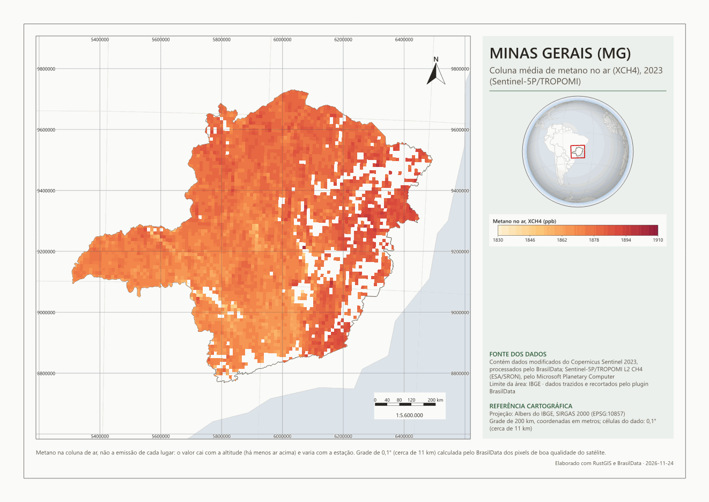

# Metano no ar (Sentinel-5P)

<!-- Gerado por scripts/gerar.py a partir do fontes.csv e do fichas.csv; não edite à mão. -->

A coluna média de metano no ar (XCH4) medida pelo Sentinel-5P/TROPOMI, em média do ano ou do mês, numa grade de 0,1° calculada pelo BrasilData das órbitas do satélite.

*Mapa exemplo: Minas Gerais, feito com o plugin.*

| | |
|---|---|
| **Onde na aba** | Tempo e clima › Atmosfera |
| **Fonte** | ESA/Copernicus (Sentinel-5P), processado pelo BrasilData. |
| **Período** | 2023 (o ano e cada mês; 2023 é o ano mais recente com todas as órbitas no Planetary Computer). |
| **Resolução ou escala** | 0,1° (cerca de 11 km); o pixel do satélite tem cerca de 7 × 5,5 km. |
| **Unidades** | ppb (partes por bilhão, fração molar no ar seco). |
| **Legenda** | Escala contínua do amarelo ao vermelho, de 1.830 a 1.910 ppb, a mesma em todo lugar e período. |
| **Cuidados de uso** | Mede o metano no ar, não a emissão de cada lugar: o valor cai com a altitude (há menos ar acima) e varia com a estação. Só pixels de boa qualidade (qa > 0,5), e as células com menos de 3 observações no mês (10 no ano) ficam vazias: a média do ano cobre 59% do Brasil (86% de Minas Gerais), os meses, de 2% (janeiro) a 58% (julho), e quase toda a Amazônia fica sem dado. A média do ano pesa mais os meses de maio a setembro, os de mais observações. Até a versão 0.1.69 o dado incluía, por engano, pixels de qualidade ruim, e os valores da Amazônia e do litoral do Nordeste eram baixos demais. |
| **Licença** | livre e aberto (licença dos dados Copernicus Sentinel), com a citação. |
| **Citação** | Contém dados modificados do Copernicus Sentinel 2023, processados pelo BrasilData; Sentinel-5P/TROPOMI L2 CH4 (ESA/SRON), pelo Microsoft Planetary Computer. |
| **App desktop** | sim |
| **App web** | sim (o GitHub libera a leitura pelo navegador); precisa de um RustGIS depois da 0.5.0. |

[Todas as camadas](README.md)
