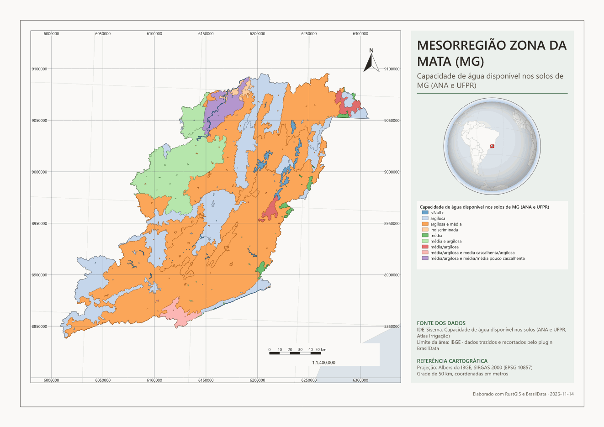

# Capacidade de água disponível nos solos de MG (ANA e UFPR)

<!-- Gerado por scripts/gerar.py a partir do fontes.csv e do fichas.csv; não edite à mão. -->

A capacidade de água disponível (CAD ou AWC) dos solos de Minas Gerais: quanta água o solo guarda para as plantas.

*Mapa exemplo: Zona da Mata (MG), feito com o plugin.*

| | |
|---|---|
| **Onde na aba** | Meio físico › Solos |
| **Fonte** | IDE-Sisema |
| **Período** | mapa da ANA e da UFPR para o Atlas Irrigação. |
| **Resolução ou escala** | a do mapa de solos de base (escala regional). |
| **Unidades** | AWC em fração de volume (m³ de água por m³ de solo: 0,12 é 1,2 mm por cm de solo). |
| **Legenda** | Polígonos com a AWC (awc), a ordem, a subordem, o grande grupo, o subgrupo e a textura do solo. |
| **Cuidados de uso** | Valores médios por classe de solo e textura, estimados por funções de pedotransferência; para o manejo da irrigação, meça no campo. |
| **Licença** | uso irrestrito (licenceUnrestricted nos metadados da IDE-Sisema). |
| **Citação** | IDE-Sisema, Capacidade de água disponível nos solos (ANA e UFPR, Atlas Irrigação). |
| **App desktop** | sim |
| **App web** | sim |

[Todas as camadas](README.md)
