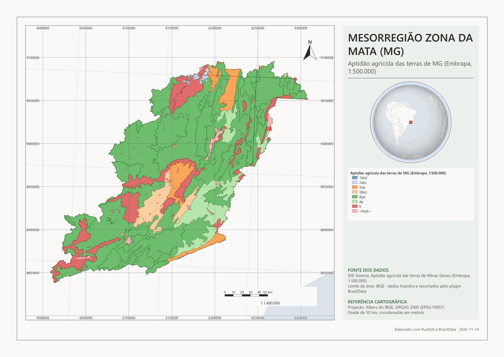

# Aptidão agrícola das terras de MG (Embrapa, 1:500.000)

<!-- Gerado por scripts/gerar.py a partir do fontes.csv e do fichas.csv; não edite à mão. -->

A aptidão agrícola das terras de Minas Gerais: para que uso cada terra serve (lavoura, pastagem plantada, silvicultura, pastagem natural ou preservação), em três níveis de manejo.

*Mapa exemplo: Zona da Mata (MG), feito com o plugin.*

| | |
|---|---|
| **Onde na aba** | Meio físico › Solos |
| **Fonte** | IDE-Sisema |
| **Período** | mapa da Embrapa (2ª aproximação), digitalizado pelo Sisema. |
| **Resolução ou escala** | escala 1:500.000 |
| **Unidades** | área em ha (area_ha) e km² (area_km2) |
| **Legenda** | Polígonos pelo símbolo do sistema de aptidão (simb_apt, como 3(a) ou 4p) e o texto da legenda; os solos e a aptidão de até quatro componentes. 1 a 3: lavouras; 4: pastagem plantada; 5: silvicultura ou pastagem natural; 6: preservação. Letras maiúsculas, aptidão boa; minúsculas, regular; entre parênteses, restrita. |
| **Cuidados de uso** | Classificação de pequena escala; não substitui a avaliação da terra na propriedade. Áreas urbanas e corpos d'água ficam sem símbolo. |
| **Licença** | uso irrestrito (licenceUnrestricted nos metadados da IDE-Sisema). |
| **Citação** | IDE-Sisema, Aptidão agrícola das terras de Minas Gerais (Embrapa, 1:500.000). |
| **App desktop** | sim |
| **App web** | sim |

[Todas as camadas](README.md)
