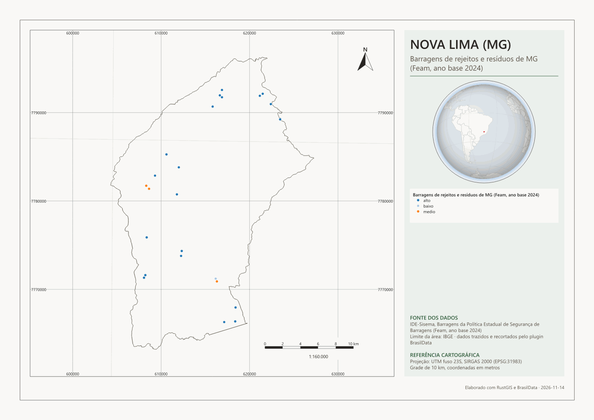

# Barragens de rejeitos e resíduos de MG (Feam, ano base 2024)

<!-- Gerado por scripts/gerar.py a partir do fontes.csv e do fichas.csv; não edite à mão. -->

As barragens de rejeitos e resíduos industriais e de mineração enquadradas na Política Estadual de Segurança de Barragens de Minas Gerais.

*Mapa exemplo: Nova Lima (MG), feito com o plugin.*

| | |
|---|---|
| **Onde na aba** | Meio físico › Geologia e recursos minerais. |
| **Fonte** | IDE-Sisema |
| **Período** | cadastro da Feam, ano base 2024 |
| **Resolução ou escala** | pontos |
| **Unidades** | sem unidade |
| **Legenda** | Pontos com o nome da estrutura, o tipo (mineração ou indústria), o método construtivo (etapa única, jusante, montante, linha de centro), a finalidade, a classe (A a E), o dano potencial associado (pda: baixo, médio, alto) e a classe dos resíduos. |
| **Cuidados de uso** | Só as barragens da política estadual; as de mineração também estão no SIGBM da ANM, com outro cadastro. O empreendedor fica de fora da tabela. |
| **Licença** | licença não declarada no serviço |
| **Citação** | IDE-Sisema, Barragens da Política Estadual de Segurança de Barragens (Feam, ano base 2024). |
| **App desktop** | sim |
| **App web** | sim |

[Todas as camadas](README.md)
