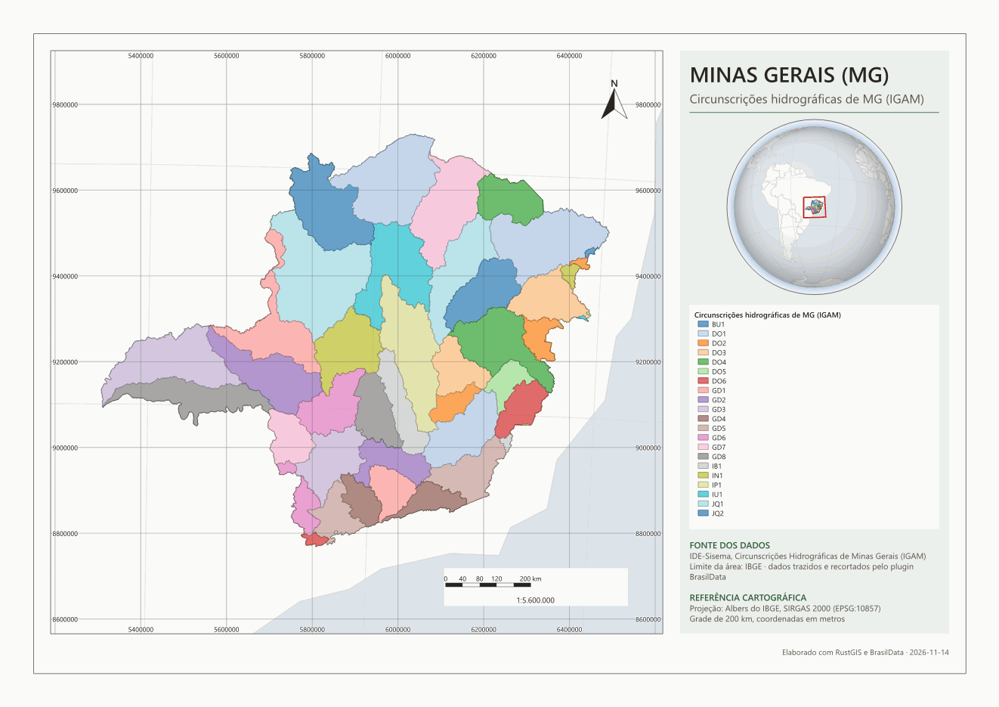

# Circunscrições hidrográficas de MG (IGAM)

<!-- Gerado por scripts/gerar.py a partir do fontes.csv e do fichas.csv; não edite à mão. -->

As circunscrições hidrográficas (CHs) de Minas Gerais: as unidades de planejamento e gestão dos recursos hídricos do estado, cada uma com o seu comitê de bacia.

*Mapa exemplo: Minas Gerais, feito com o plugin.*

| | |
|---|---|
| **Onde na aba** | Água › Bacias |
| **Fonte** | IDE-Sisema |
| **Período** | delimitação vigente do IGAM |
| **Resolução ou escala** | limites sobre a base hidrográfica ottocodificada. |
| **Unidades** | área em km² (area_km2) |
| **Legenda** | Polígonos pela sigla (como DO1 ou PS2) e o nome, com a unidade estratégica de gestão, o comitê, a bacia federal e a situação do plano diretor, do enquadramento e da cobrança. |
| **Cuidados de uso** | As CHs substituíram as antigas UPGRHs, com as mesmas siglas na maioria. |
| **Licença** | licença não declarada no serviço |
| **Citação** | IDE-Sisema, Circunscrições Hidrográficas de Minas Gerais (IGAM). |
| **App desktop** | sim |
| **App web** | sim |

[Todas as camadas](README.md)
