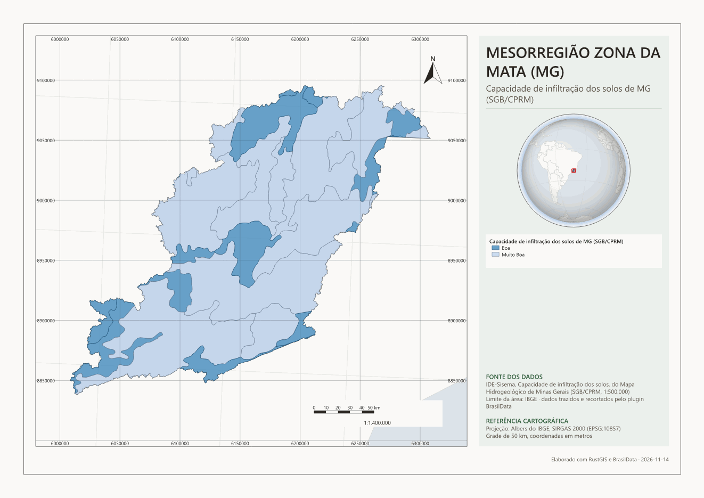

# Capacidade de infiltração dos solos de MG (SGB/CPRM)

<!-- Gerado por scripts/gerar.py a partir do fontes.csv e do fichas.csv; não edite à mão. -->

A capacidade de infiltração da água nos solos de Minas Gerais, do Mapa Hidrogeológico do Serviço Geológico do Brasil.

*Mapa exemplo: Zona da Mata (MG), feito com o plugin.*

| | |
|---|---|
| **Onde na aba** | Meio físico › Solos |
| **Fonte** | IDE-Sisema |
| **Período** | Mapa Hidrogeológico de Minas Gerais (SGB/CPRM). |
| **Resolução ou escala** | escala 1:500.000 (1:100.000 no Quadrilátero Ferrífero). |
| **Unidades** | sem unidade |
| **Legenda** | Polígonos pela infiltração (muito boa, boa, moderada, baixa...) e pela drenagem interna, com a classe de solo do SiBCS. |
| **Cuidados de uso** | Classes qualitativas, deduzidas do tipo de solo; não medem a taxa de infiltração no campo. |
| **Licença** | uso irrestrito (licenceUnrestricted nos metadados da IDE-Sisema). |
| **Citação** | IDE-Sisema, Capacidade de infiltração dos solos, do Mapa Hidrogeológico de Minas Gerais (SGB/CPRM, 1:500.000). |
| **App desktop** | sim |
| **App web** | sim |

[Todas as camadas](README.md)
