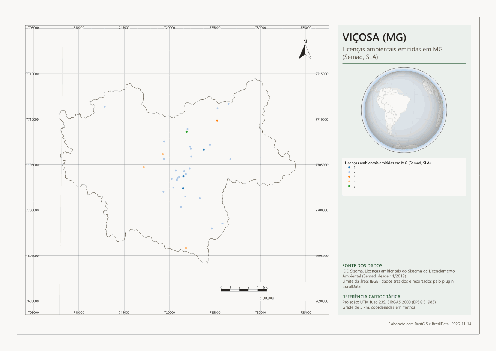

# Licenças ambientais emitidas em MG (Semad, SLA)

<!-- Gerado por scripts/gerar.py a partir do fontes.csv e do fichas.csv; não edite à mão. -->

Os empreendimentos com licença ambiental emitida pela Semad no Sistema de Licenciamento Ambiental (SLA) de Minas Gerais.

*Mapa exemplo: Viçosa (MG), feito com o plugin.*

| | |
|---|---|
| **Onde na aba** | Vegetação e meio ambiente › Fiscalização |
| **Fonte** | IDE-Sisema |
| **Período** | licenças emitidas desde novembro de 2019 |
| **Resolução ou escala** | pontos (a coordenada declarada do empreendimento). |
| **Unidades** | sem unidade |
| **Legenda** | Pontos com a solicitação, o processo, o município, a atividade principal (código e descrição da DN Copam 217/2017), a classe (1 a 6), o fator locacional, a modalidade (LAS, LAC, LAT), a fase, a unidade que analisou, a emissão, a validade e o endereço do processo no SLA. |
| **Cuidados de uso** | Só as licenças estaduais do SLA; as municipais e as do sistema antigo (Siam) ficam de fora. O empreendedor (nome e CPF/CNPJ) fica de fora da tabela. |
| **Licença** | licença não declarada no serviço |
| **Citação** | IDE-Sisema, Licenças ambientais do Sistema de Licenciamento Ambiental (Semad, desde 11/2019). |
| **App desktop** | sim |
| **App web** | sim |

[Todas as camadas](README.md)
