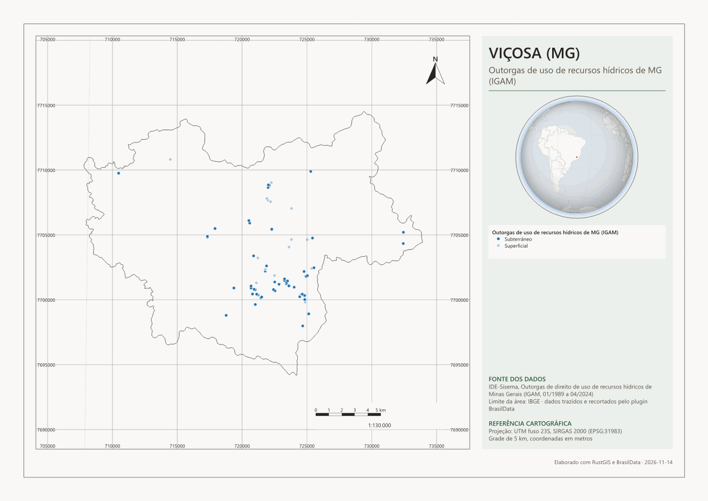

# Outorgas de uso de recursos hídricos de MG (IGAM)

<!-- Gerado por scripts/gerar.py a partir do fontes.csv e do fichas.csv; não edite à mão. -->

As outorgas de direito de uso de recursos hídricos concedidas pelo IGAM em Minas Gerais: captações, poços, barramentos e outros usos.

*Mapa exemplo: Viçosa (MG), feito com o plugin.*

| | |
|---|---|
| **Onde na aba** | Água › Recursos hídricos |
| **Fonte** | IDE-Sisema |
| **Período** | outorgas vigentes de 01/1989 a 02/04/2024. |
| **Resolução ou escala** | pontos (a coordenada declarada da captação). |
| **Unidades** | volume captado no ano em m³ (volcapanua); área irrigada em ha (aririgha_4). |
| **Legenda** | Pontos com o processo e a portaria, a situação, a vigência, o tipo de uso (superficial ou subterrâneo), o modo de uso, a finalidade, o tipo de consumo, o município, a circunscrição hidrográfica, o curso d'água e a ottobacia. |
| **Cuidados de uso** | Só as outorgas estaduais; as de rios de domínio da União são da ANA. O empreendimento e o CPF/CNPJ do usuário ficam de fora da tabela. |
| **Licença** | licença não declarada no serviço |
| **Citação** | IDE-Sisema, Outorgas de direito de uso de recursos hídricos de Minas Gerais (IGAM, 01/1989 a 04/2024). |
| **App desktop** | sim |
| **App web** | sim |

[Todas as camadas](README.md)
