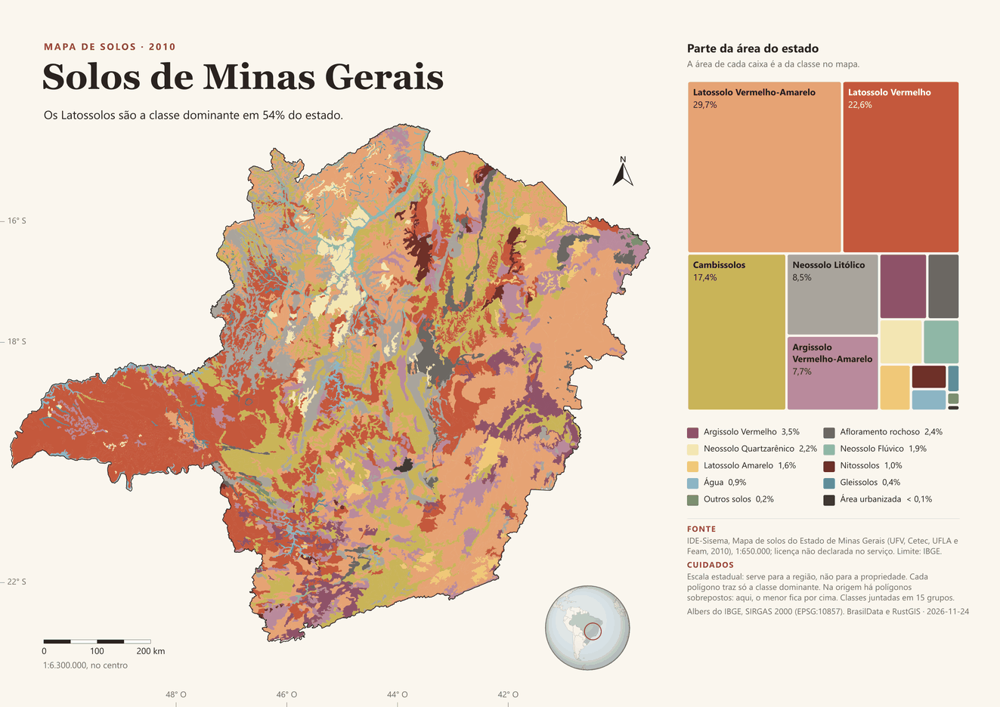

# Mapa de solos de Minas Gerais (UFV, Cetec, UFLA e Feam, 2010)

<!-- Gerado por scripts/gerar.py a partir do fontes.csv e do fichas.csv; não edite à mão. -->

O mapa de solos de Minas Gerais: as unidades de mapeamento com a classe de solo dominante, do levantamento da UFV, do Cetec, da UFLA e da Feam.

*Mapa exemplo: Minas Gerais, com o dado do plugin e a folha feita à parte no RustGIS.*

| | |
|---|---|
| **Onde na aba** | Meio físico › Solos |
| **Fonte** | IDE-Sisema |
| **Período** | levantamento publicado em 2010 |
| **Resolução ou escala** | escala 1:650.000 (mapa estadual) |
| **Unidades** | sem unidade |
| **Legenda** | Polígonos pela legenda: a classe do SiBCS até o 3º ou 4º nível (por exemplo Latossolo vermelho-amarelo distrófico). |
| **Cuidados de uso** | Escala estadual, mais grossa que a do IBGE (1:250.000): serve para a região, não para a propriedade. Cada polígono traz só a classe dominante. |
| **Licença** | licença não declarada no serviço |
| **Citação** | IDE-Sisema, Mapa de solos do Estado de Minas Gerais (UFV, Cetec, UFLA e Feam, 2010). |
| **App desktop** | sim |
| **App web** | sim |

[Todas as camadas](README.md)
