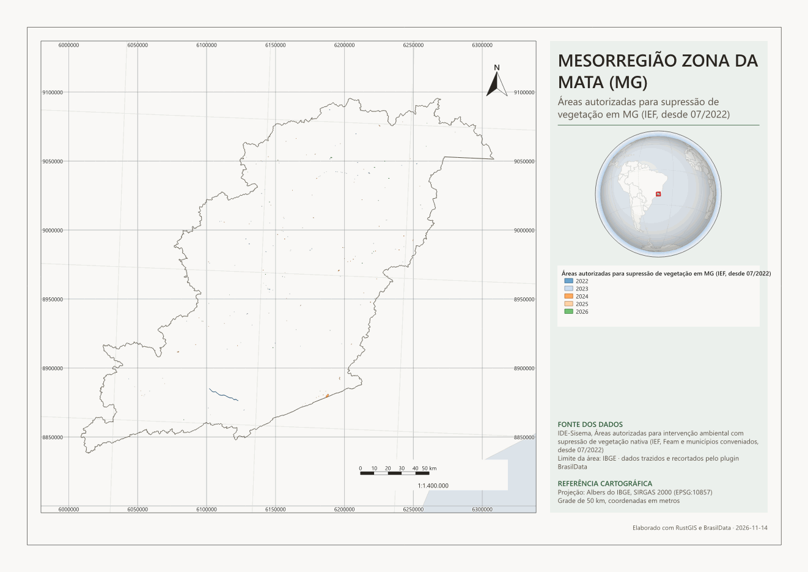

# Áreas autorizadas para supressão de vegetação em MG (IEF, desde 07/2022)

<!-- Gerado por scripts/gerar.py a partir do fontes.csv e do fichas.csv; não edite à mão. -->

As áreas autorizadas para intervenção ambiental com supressão de vegetação nativa em Minas Gerais, pelo IEF, pela Feam e pelos municípios conveniados.

*Mapa exemplo: Zona da Mata (MG), feito com o plugin.*

| | |
|---|---|
| **Onde na aba** | Vegetação e meio ambiente › Desmatamento |
| **Fonte** | IDE-Sisema |
| **Período** | processos deferidos desde julho de 2022 |
| **Resolução ou escala** | polígonos da área autorizada |
| **Unidades** | área autorizada em ha (area_autor) |
| **Legenda** | Polígonos com o processo, a modalidade, a área autorizada, a data de publicação, o ano, a decisão, o bioma e a unidade que autorizou. |
| **Cuidados de uso** | É a área autorizada, não a supressão feita. As autorizações anteriores a julho de 2022 não estão na camada. |
| **Licença** | uso irrestrito (licenceUnrestricted nos metadados da IDE-Sisema). |
| **Citação** | IDE-Sisema, Áreas autorizadas para intervenção ambiental com supressão de vegetação nativa (IEF, Feam e municípios conveniados, desde 07/2022). |
| **App desktop** | sim |
| **App web** | sim |

[Todas as camadas](README.md)
