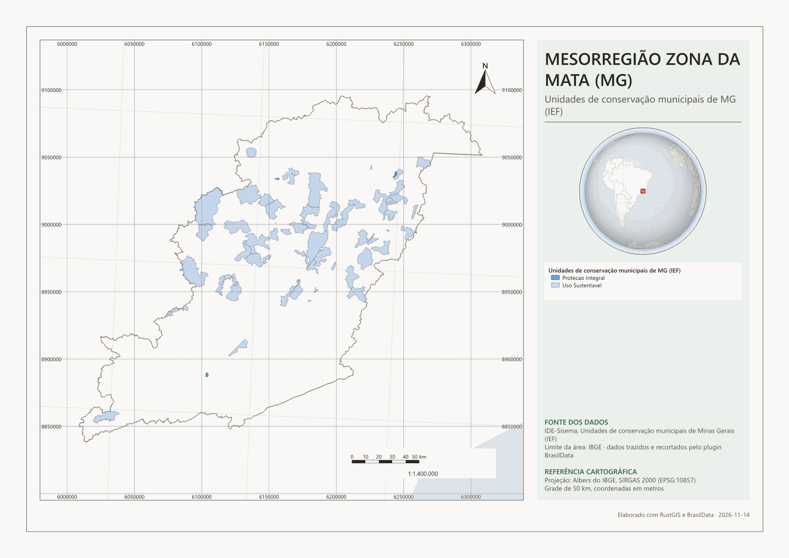

# Unidades de conservação municipais de MG (IEF)

<!-- Gerado por scripts/gerar.py a partir do fontes.csv e do fichas.csv; não edite à mão. -->

As unidades de conservação municipais de Minas Gerais registradas pelo IEF.

*Mapa exemplo: Zona da Mata (MG), feito com o plugin.*

| | |
|---|---|
| **Onde na aba** | Vegetação e meio ambiente › Áreas protegidas. |
| **Fonte** | IDE-Sisema |
| **Período** | base do IEF na data do pedido |
| **Resolução ou escala** | limites legais digitalizados (escala variável). |
| **Unidades** | área oficial e geométrica em ha (area_ofic, area_geo). |
| **Legenda** | Polígonos pela categoria (APA, parque natural municipal, monumento natural...) e o grupo, com o ato legal e os municípios. |
| **Cuidados de uso** | Só as UCs municipais que chegaram ao IEF; APAs municipais podem cobrir o município inteiro. |
| **Licença** | uso irrestrito (licenceUnrestricted nos metadados da IDE-Sisema). |
| **Citação** | IDE-Sisema, Unidades de conservação municipais de Minas Gerais (IEF). |
| **App desktop** | sim |
| **App web** | sim |

[Todas as camadas](README.md)
