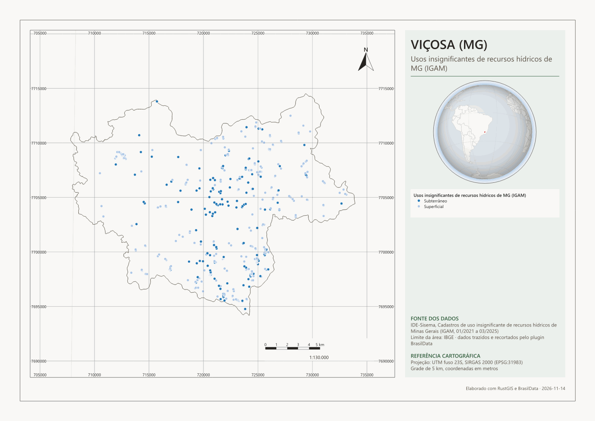

# Usos insignificantes de recursos hídricos de MG (IGAM)

<!-- Gerado por scripts/gerar.py a partir do fontes.csv e do fichas.csv; não edite à mão. -->

Os cadastros de uso insignificante de recursos hídricos de Minas Gerais: os usos pequenos que dispensam outorga, mas precisam ser cadastrados no IGAM.

*Mapa exemplo: Viçosa (MG), feito com o plugin.*

| | |
|---|---|
| **Onde na aba** | Água › Recursos hídricos |
| **Fonte** | IDE-Sisema |
| **Período** | cadastros vigentes de 01/2021 a 28/03/2025. |
| **Resolução ou escala** | pontos (a coordenada declarada) |
| **Unidades** | volume captado no ano em m³ (vcapanual) |
| **Legenda** | Pontos com o certificado, o processo, a vigência, o tipo de uso, o modo de uso (barramento, poço manual, nascente...), a finalidade, o município, a circunscrição hidrográfica e o curso d'água. |
| **Cuidados de uso** | Cadastros declarados pelo usuário, sem vistoria. O nome do imóvel e do usuário fica de fora da tabela. |
| **Licença** | uso irrestrito (licenceUnrestricted nos metadados da IDE-Sisema). |
| **Citação** | IDE-Sisema, Cadastros de uso insignificante de recursos hídricos de Minas Gerais (IGAM, 01/2021 a 03/2025). |
| **App desktop** | sim |
| **App web** | sim |

[Todas as camadas](README.md)
