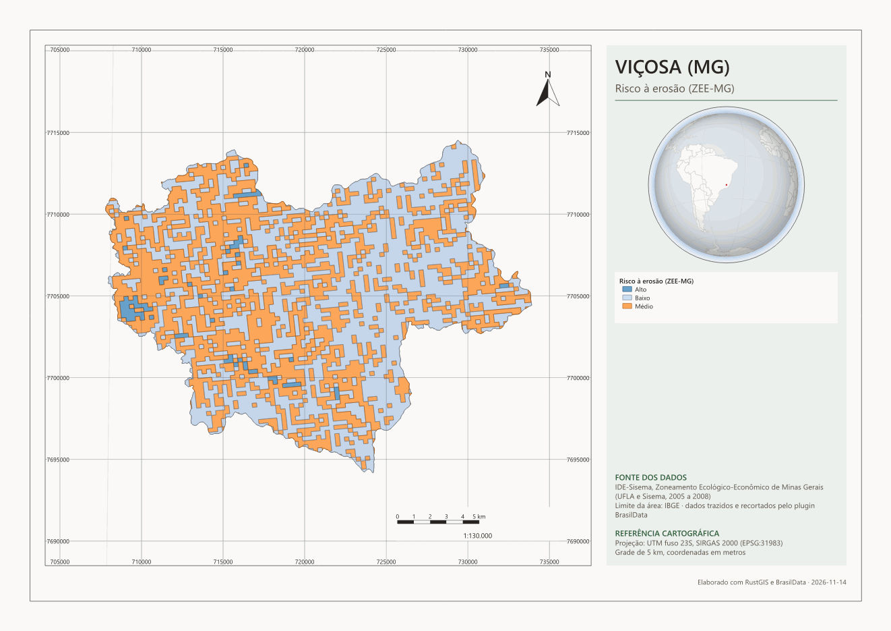

# Risco à erosão (ZEE-MG)

<!-- Gerado por scripts/gerar.py a partir do fontes.csv e do fichas.csv; não edite à mão. -->

O risco potencial de erosão do ZEE-MG: a erodibilidade dos solos combinada com a declividade, sem contar a cobertura do solo.

*Mapa exemplo: Viçosa (MG), feito com o plugin.*

| | |
|---|---|
| **Onde na aba** | Meio físico › Solos |
| **Fonte** | IDE-Sisema |
| **Período** | ZEE-MG, elaborado de 2005 a 2008 |
| **Resolução ou escala** | grade regular convertida em polígonos (escala estadual). |
| **Unidades** | sem unidade |
| **Legenda** | Polígonos pelo indicador: muito baixo, baixo, médio, alto ou muito alto. |
| **Cuidados de uso** | É o risco do meio físico, sem a cobertura da terra; os polígonos vêm de uma grade e são muitos numa área grande. |
| **Licença** | licença não declarada no serviço |
| **Citação** | IDE-Sisema, Zoneamento Ecológico-Econômico de Minas Gerais (UFLA e Sisema, 2005 a 2008). |
| **App desktop** | sim |
| **App web** | sim |

[Todas as camadas](README.md)
