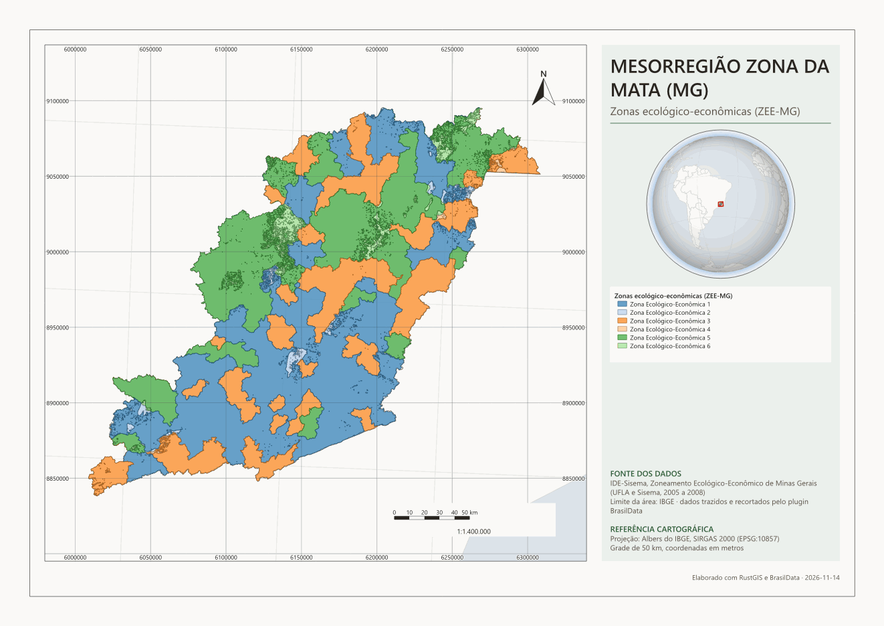

# Zonas ecológico-econômicas (ZEE-MG)

<!-- Gerado por scripts/gerar.py a partir do fontes.csv e do fichas.csv; não edite à mão. -->

As zonas ecológico-econômicas de Minas Gerais: o cruzamento da potencialidade social com a vulnerabilidade natural, síntese do ZEE-MG.

*Mapa exemplo: Zona da Mata (MG), feito com o plugin.*

| | |
|---|---|
| **Onde na aba** | Território › Zoneamento ecológico-econômico. |
| **Fonte** | IDE-Sisema |
| **Período** | ZEE-MG, elaborado de 2005 a 2008 |
| **Resolução ou escala** | grade regular convertida em polígonos (escala estadual). |
| **Unidades** | sem unidade |
| **Legenda** | Polígonos pela zona ecológico-econômica, de 1 a 6 (campo indicador), do cruzamento das classes de potencialidade social e de vulnerabilidade natural. |
| **Cuidados de uso** | Instrumento de planejamento, não de licenciamento; os dados de base são de 2005 a 2008. |
| **Licença** | licença não declarada no serviço |
| **Citação** | IDE-Sisema, Zoneamento Ecológico-Econômico de Minas Gerais (UFLA e Sisema, 2005 a 2008). |
| **App desktop** | sim |
| **App web** | sim |

[Todas as camadas](README.md)
