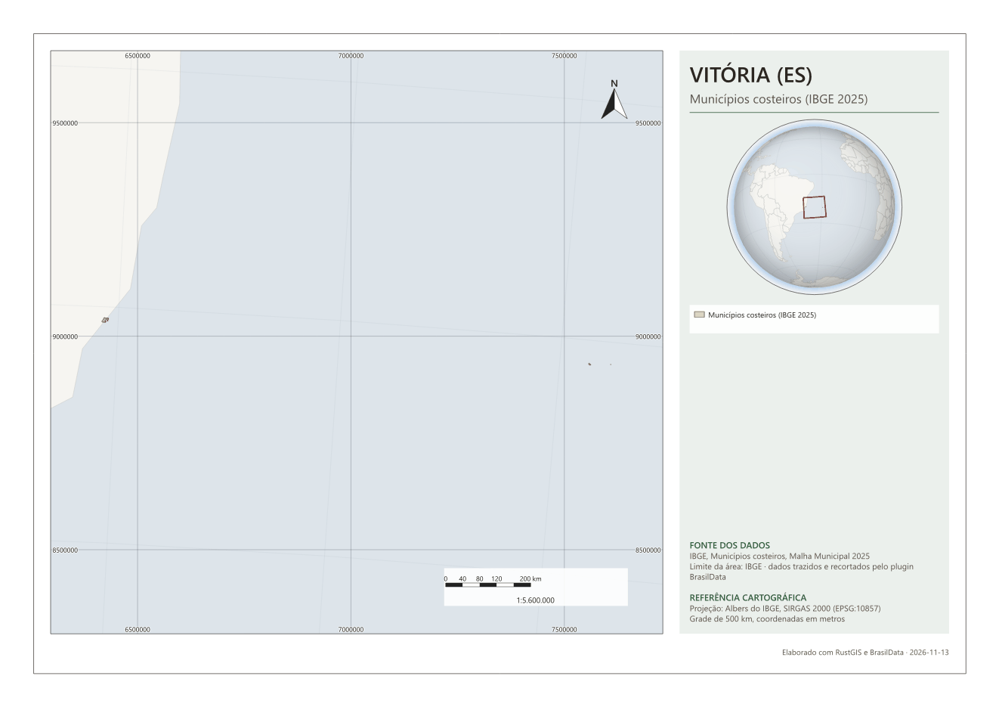

# Municípios costeiros (IBGE 2025)

<!-- Gerado por scripts/gerar.py a partir do fontes.csv e do fichas.csv; não edite à mão. -->

Os municípios da zona costeira, pelo Plano Nacional de Gerenciamento Costeiro.

*Mapa exemplo: Vitória (ES), feito com o plugin.*

| | |
|---|---|
| **Onde na aba** | Território › Recortes especiais |
| **Fonte** | IBGE |
| **Período** | Malha Municipal 2025 |
| **Resolução ou escala** | limites municipais (1:250.000) |
| **Unidades** | sem unidade |
| **Legenda** | Um polígono por município. |
| **Cuidados de uso** | Recorte legal ou estatístico definido por lei ou pelo IBGE; vem só a parte dentro da área. |
| **Licença** | uso livre com citação da fonte |
| **Citação** | IBGE, Municípios costeiros, Malha Municipal 2025. |
| **App desktop** | sim |
| **App web** | sim |

[Todas as camadas](README.md)
