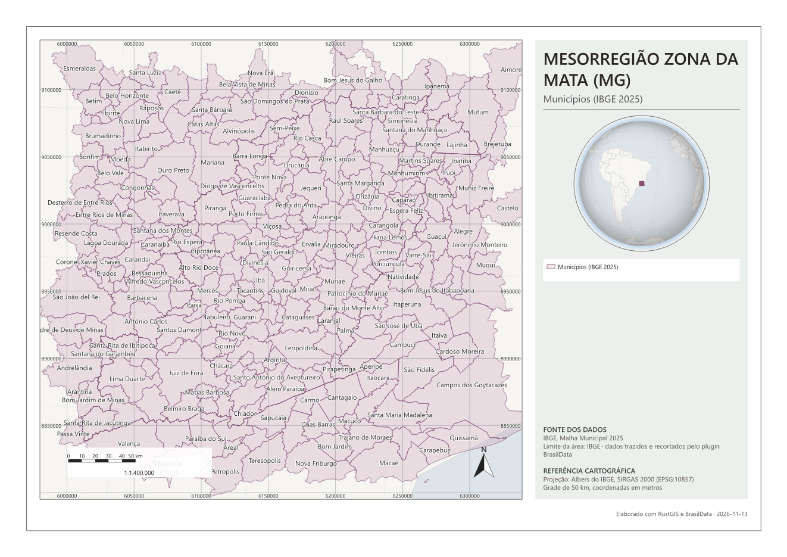

# Municípios (IBGE 2025)

<!-- Gerado por scripts/gerar.py a partir do fontes.csv e do fichas.csv; não edite à mão. -->

Os limites municipais oficiais.

*Mapa exemplo: Zona da Mata (MG), feito com o plugin.*

| | |
|---|---|
| **Onde na aba** | Território › Limites |
| **Fonte** | IBGE |
| **Período** | Malha Municipal 2025 do IBGE (a divisão vigente em 2025). |
| **Resolução ou escala** | escala 1:250.000 |
| **Unidades** | área em km² (area_km2) |
| **Legenda** | Um polígono por município: código de 7 dígitos, nome, UF e área (cd_mun, nm_mun, sigla_uf, area_km2). |
| **Cuidados de uso** | Limites para mapas e estatística, não para demarcação legal. Vem o polígono inteiro de cada unidade que cruza a área, sem recorte. O limite de 1:250.000 pode diferir dos limites estaduais mais detalhados. |
| **Licença** | uso livre com citação da fonte |
| **Citação** | IBGE, Malha Municipal 2025 |
| **App desktop** | sim |
| **App web** | sim |

[Todas as camadas](README.md)
