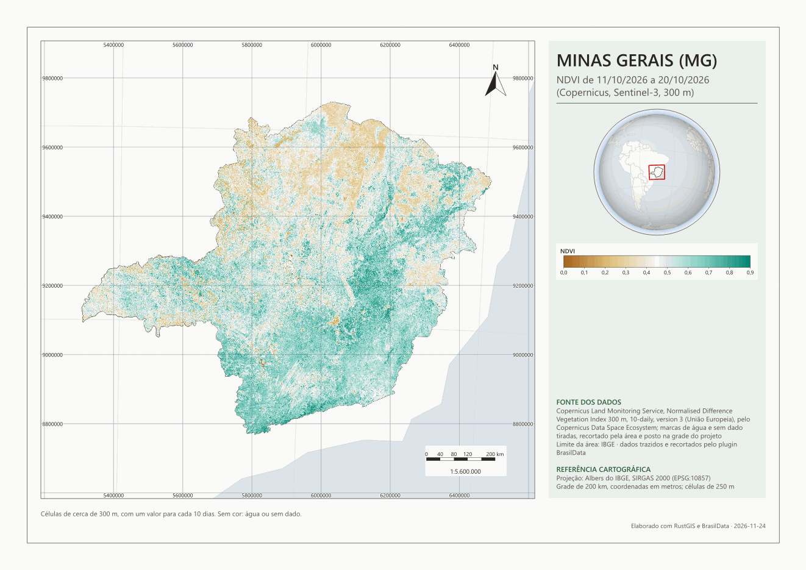

# NDVI a 300 m, de 10 em 10 dias (Copernicus)

<!-- Gerado por scripts/gerar.py a partir do fontes.csv e do fichas.csv; não edite à mão. -->

O índice de vegetação NDVI do serviço de terra do Copernicus (CLMS, versão 3), um mapa global a cada 10 dias, do Sentinel-3 (e do PROBA-V até dezembro de 2018).

*Mapa exemplo: Minas Gerais, feito com o plugin.*

| | |
|---|---|
| **Onde na aba** | Vegetação e meio ambiente › Vegetação |
| **Fonte** | Copernicus Land Monitoring Service (União Europeia). |
| **Período** | de 10 em 10 dias, de 01/01/2014 à data mais recente do catálogo. |
| **Resolução ou escala** | 1/336° (cerca de 300 m), posta na grade do projeto; numa área maior que uns 23° (o Brasil inteiro), a visão reduzida do arquivo (cerca de 1,3 km), que guarda uma célula de cada 4 × 4, sem média. |
| **Unidades** | NDVI, de -0,08 a 0,92 |
| **Legenda** | Escala contínua do marrom (solo exposto) ao verde (vegetação densa), de 0 a 0,9, a mesma do índice de vegetação do cubo do INPE. |
| **Cuidados de uso** | Uma célula de 300 m mistura lavoura, pasto e mata: boa para municípios, regiões e estados, não para talhões. Água e falta de dado ficam sem cor. Na estação chuvosa, a nuvem persistente pode deixar falhas ou um valor mais baixo que o real. O satélite muda de 2018 para 2019 (do PROBA-V para o Sentinel-3): numa série longa, parte da diferença pode vir da troca. Pede o login do Copernicus Data Space. |
| **Licença** | política de dados do Copernicus: uso livre e gratuito, com a citação. |
| **Citação** | Copernicus Land Monitoring Service, Normalised Difference Vegetation Index 300 m, 10-daily, version 3 (União Europeia), pelo Copernicus Data Space Ecosystem. |
| **App desktop** | sim |
| **App web** | ainda não testado no web (o login é o do app web). |

[Todas as camadas](README.md)
