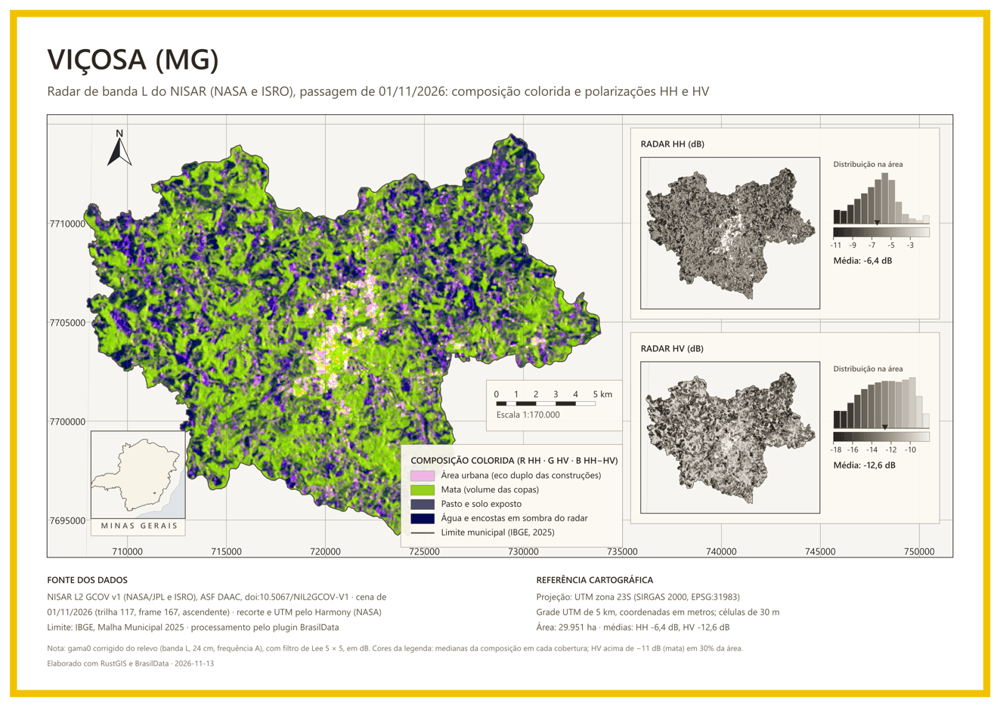

# Radar HH (NISAR, banda L)

<!-- Gerado por scripts/gerar.py a partir do fontes.csv e do fichas.csv; não edite à mão. -->

O retroespalhamento do radar de banda L do NISAR na polarização HH, que responde mais aos troncos, ao solo e às construções.

*Mapa exemplo: Viçosa (MG), feito com o plugin.*

| | |
|---|---|
| **Onde na aba** | Vegetação e meio ambiente › Uso e cobertura. |
| **Fonte** | NASA/JPL e ISRO (ASF DAAC) |
| **Período** | a passagem mais recente, ou a do dia escolhido. |
| **Resolução ou escala** | 20 m |
| **Unidades** | dB |
| **Legenda** | Escala de cinza, de −11 a −1 dB. |
| **Cuidados de uso** | Missão nova (2025): ainda há poucas passagens em cada lugar. A banda L atravessa mais as copas que a banda C, mas o relevo íngreme deixa sombras. Pede o login Earthdata; áreas de até cerca de 110 km. |
| **Licença** | dados da NASA de uso livre e aberto, com citação. |
| **Citação** | NISAR Geocoded Polarimetric Covariance Product, version 1 (NISAR_L2_GCOV_V1), NASA/JPL e ISRO, ASF DAAC, doi:10.5067/NIL2GCOV-V1. |
| **App desktop** | sim |
| **App web** | No app web: depende do login Earthdata, que o RustGIS guarda no desktop; ainda não testado no web. |

[Todas as camadas](README.md)
