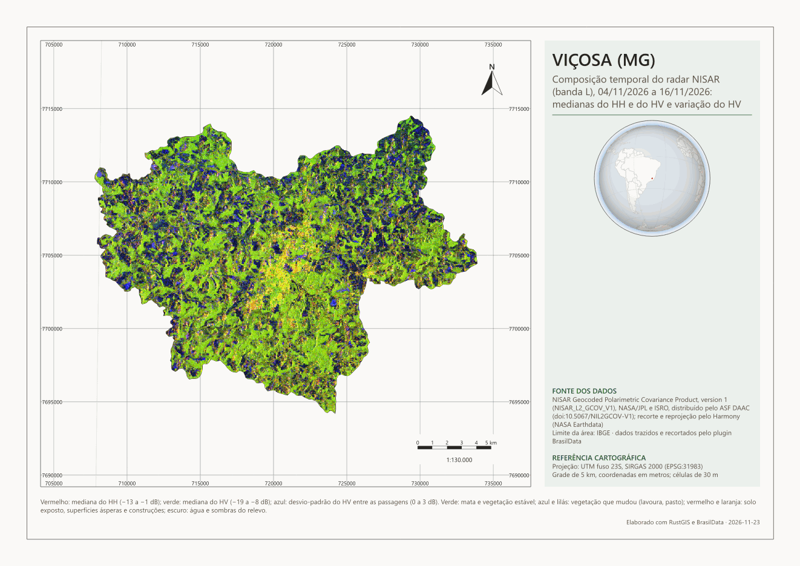

# Composição temporal (NISAR, banda L)

<!-- Gerado por scripts/gerar.py a partir do fontes.csv e do fichas.csv; não edite à mão. -->

A composição temporal do NISAR: a mediana do HH no vermelho, a mediana do HV no verde e o desvio-padrão do HV entre as passagens no azul.

*Mapa exemplo: Viçosa (MG), feito com o plugin.*

| | |
|---|---|
| **Onde na aba** | Vegetação e meio ambiente › Uso e cobertura. |
| **Fonte** | NASA/JPL e ISRO (ASF DAAC) |
| **Período** | as passagens mais recentes da mesma trilha (de 2 a 8, uma a cada 12 dias). |
| **Resolução ou escala** | 20 m |
| **Unidades** | dB em cada canal (o azul, desvio-padrão em dB). |
| **Legenda** | Mata e vegetação estável em verde, vegetação que mudou (lavoura, pasto) em azul e lilás, solo exposto e construções em vermelho e laranja, água e sombras do relevo escuras. |
| **Cuidados de uso** | A mediana de várias passagens tira o granulado, mas o desvio do HV também sobe com a umidade do solo e a chuva entre as passagens. Missão nova (2025): poucas passagens em cada lugar. O relevo íngreme deixa sombras. Pede o login Earthdata; áreas de até cerca de 110 km. |
| **Licença** | dados da NASA de uso livre e aberto, com citação. |
| **Citação** | NISAR Geocoded Polarimetric Covariance Product, version 1 (NISAR_L2_GCOV_V1), NASA/JPL e ISRO, ASF DAAC, doi:10.5067/NIL2GCOV-V1. |
| **App desktop** | sim |
| **App web** | No app web: depende do login Earthdata, que o RustGIS guarda no desktop; ainda não testado no web. |

[Todas as camadas](README.md)
