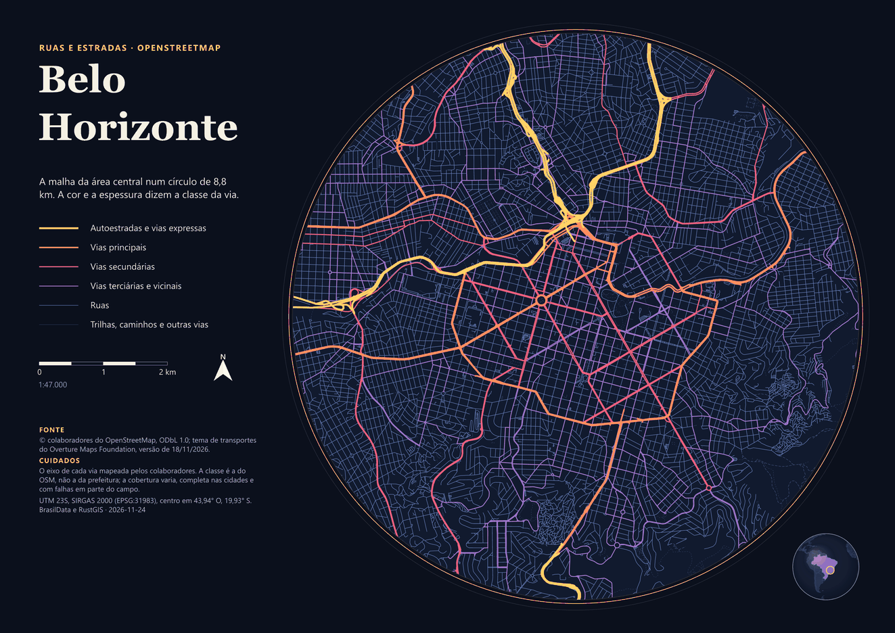

# Ruas e estradas (OpenStreetMap)

<!-- Gerado por scripts/gerar.py a partir do fontes.csv e do fichas.csv; não edite à mão. -->

As ruas e estradas do OpenStreetMap, pela classe da via (o highway do OSM): autoestradas, vias principais, secundárias e terciárias, ruas, estradas de terra e trilhas.

*Mapa exemplo: Belo Horizonte (MG), com o dado do plugin e a folha feita à parte no RustGIS.*

| | |
|---|---|
| **Onde na aba** | Infraestrutura › Transportes |
| **Fonte** | OpenStreetMap (pelo Overture Maps Foundation). |
| **Período** | a versão mais recente do tema de transportes do Overture Maps (atualizado todo mês com o OSM). |
| **Resolução ou escala** | o eixo de cada via mapeada pelos colaboradores do OSM (detalhe de rua). |
| **Unidades** | sem unidade |
| **Legenda** | Linhas pela classe (campo class): as vias expressas em vermelho, as principais em laranja, as secundárias em amarelo, as ruas em cinza, as estradas de terra e as trilhas tracejadas. Entre 1:150.000 e 1:50.000 ficam de fora as trilhas, os caminhos e as vias de serviço. |
| **Cuidados de uso** | Só de 1:150.000 para perto: de longe o RustGIS leria uma amostra das vias e elas sairiam em pedaços (para mapas regionais, Rodovias e estradas do IBGE). Não é recortada: a camada é mascarada pelo contorno da área, e mostra o que a vista mostra. Os nomes das vias não vêm (o RustGIS 0.7.0 deixa de fora o campo names do Overture). A cobertura do OSM varia: completa nas cidades, falha em parte do campo. |
| **Licença** | ODbL 1.0 (Open Database License) |
| **Citação** | © colaboradores do OpenStreetMap; tema de transportes do Overture Maps Foundation. |
| **App desktop** | sim |
| **App web** | sim (o bucket do Overture libera a leitura pelo navegador); precisa de um RustGIS que leia GeoParquet no lugar (0.7.0). |

[Todas as camadas](README.md)
