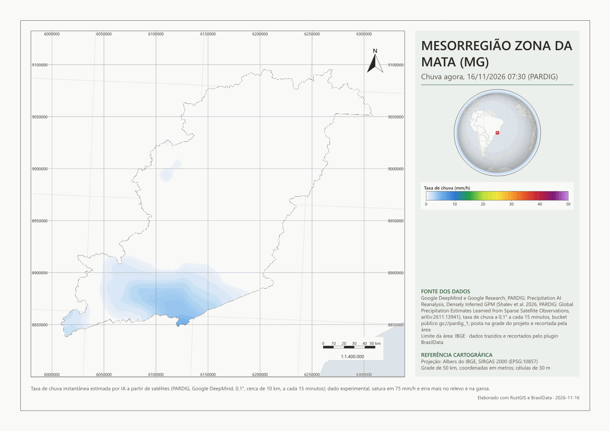

# Chuva agora (PARDIG)

<!-- Gerado por scripts/gerar.py a partir do fontes.csv e do fichas.csv; não edite à mão. -->

A taxa de chuva de um instante, estimada por inteligência artificial a partir de satélites geoestacionários e de micro-ondas, treinada nas medidas do radar do satélite GPM (PARDIG, do Google DeepMind e do Google Research).

*Mapa exemplo: Zona da Mata (MG), feito com o plugin.*

| | |
|---|---|
| **Onde na aba** | Tempo e clima › Chuva observada |
| **Fonte** | Google DeepMind |
| **Período** | um quadro de 15 minutos: o mais recente (umas 5 horas de atraso) ou o de uma hora pedida, de 1999 em diante (PARDIG-LR de 1999 a 2015, PARDIG-NRT de 2016 em diante). |
| **Resolução ou escala** | 0,1° (cerca de 10 km), a cada 15 minutos |
| **Unidades** | mm/h (a taxa instantânea, não o acumulado). |
| **Legenda** | A escala de 0 a 50 mm/h, do branco ao roxo (a cor satura acima disso). |
| **Cuidados de uso** | Dado experimental, não é observação nem alerta oficial: siga a Defesa Civil e o INMET. A taxa satura em 75 mm/h e subestima a garoa; erra mais no relevo acidentado. É um instante: para o total do dia ou do mês, use as estações do CEMADEN ou o CHIRPS. Antes de 2016 (a versão LR), as entradas mudam com o tempo, o que pode criar tendências falsas. |
| **Licença** | CC BY 4.0 (dado experimental, fornecido como está). |
| **Citação** | Google DeepMind e Google Research, PARDIG (Shalev et al. 2026, PARDIG: Global Precipitation Estimates Learned from Sparse Satellite Observations, arXiv:2611.13941). |
| **App desktop** | sim |
| **App web** | não: o servidor não aceita pedidos do app web. |

[Todas as camadas](README.md)
