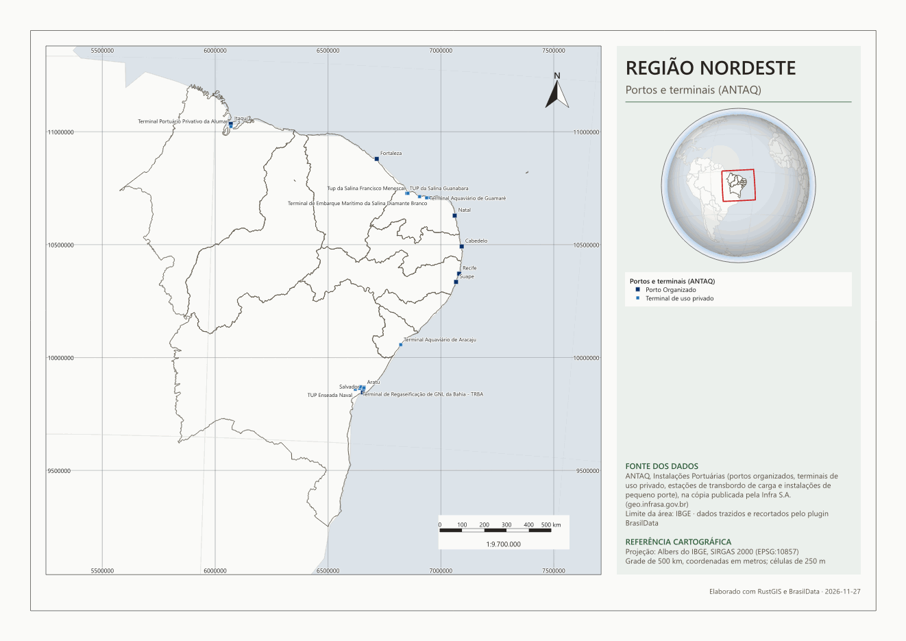

# Portos e terminais (ANTAQ)

<!-- Gerado por scripts/gerar.py a partir do fontes.csv e do fichas.csv; não edite à mão. -->

As instalações portuárias do Brasil cadastradas na ANTAQ: os portos organizados (públicos), os terminais de uso privado (TUP), as estações de transbordo de carga (ETC) e as instalações portuárias de pequeno porte (IP4) dos rios.

*Mapa exemplo: Região Nordeste, feito com o plugin.*

| | |
|---|---|
| **Onde na aba** | Infraestrutura › Transportes |
| **Fonte** | ANTAQ |
| **Período** | a base da ANTAQ (atualizada a cada trimestre) na cópia da Infra S.A. (consultada em 27/11/2026). |
| **Resolução ou escala** | pontos (a posição da instalação) |
| **Unidades** | sem unidade |
| **Legenda** | Quadrados em azuis pelo tipo: o mais escuro os portos organizados, depois os terminais de uso privado, as ETC e as IP4; o nome como rótulo. Campos: nome, tipo, município, UF e hidrovia. |
| **Cuidados de uso** | Um porto organizado é um ponto só, embora tenha vários terminais e berços. A movimentação de carga está no Estatístico Aquaviário da ANTAQ. |
| **Licença** | não declarada no serviço |
| **Citação** | ANTAQ, Instalações Portuárias (portos organizados, terminais de uso privado, estações de transbordo de carga e instalações de pequeno porte), na cópia publicada pela Infra S.A. (geo.infrasa.gov.br). |
| **App desktop** | sim |
| **App web** | sim |

[Todas as camadas](README.md)
