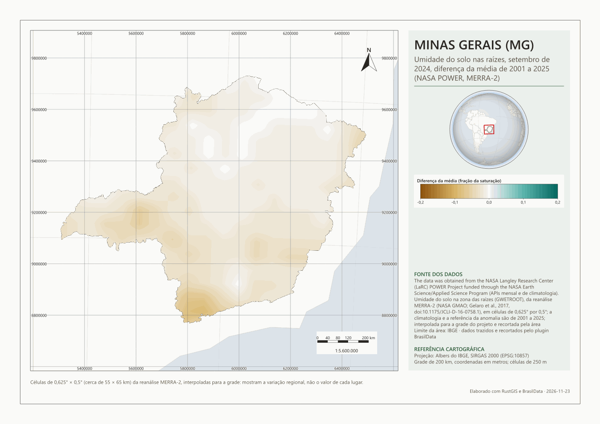

# Umidade do solo nas raízes (NASA POWER)

<!-- Gerado por scripts/gerar.py a partir do fontes.csv e do fichas.csv; não edite à mão. -->

A umidade do solo na zona das raízes (o primeiro metro), da reanálise MERRA-2, e a anomalia dela.

*Mapa exemplo: Minas Gerais, feito com o plugin.*

| | |
|---|---|
| **Onde na aba** | Tempo e clima › Clima |
| **Fonte** | NASA Langley (POWER) e NASA GMAO (MERRA-2). |
| **Período** | média de 2001 a 2025, ou um mês ou ano de 1981 a setembro de 2026 (o valor ou a anomalia). |
| **Resolução ou escala** | 0,625° × 0,5° (cerca de 55 × 65 km), interpolada para a grade do projeto. |
| **Unidades** | fração da saturação, de 0 (seco) a 1 (saturado). |
| **Legenda** | Do marrom (seco) ao verde-azulado (úmido), de 0,2 a 1; a anomalia, de −0,2 a 0,2, com branco no zero. |
| **Cuidados de uso** | É um modelo de cerca de 50 km: mostra a variação regional, não o valor de um lugar. A umidade depende do solo do modelo: compare um lugar com a média dele (a anomalia), mais que dois lugares entre si. Não foi comparado com medidas em campo pelo BrasilData. Os meses vão até setembro de 2026, quando o POWER passa do MERRA-2 para o GEOS-IT, outro modelo. Não serve para tendências: os satélites que alimentam o modelo mudaram desde 1981. O mar não tem dado: na faixa da costa, o valor vem só das células de terra. Numa área com menos de umas 10 células, use o valor como regional. |
| **Licença** | política de dados da NASA: uso livre e gratuito, com a citação. |
| **Citação** | NASA Langley Research Center (LaRC) POWER Project, APIs mensal e de climatologia, GWETROOT (MERRA-2; Gelaro et al., 2017, doi:10.1175/JCLI-D-16-0758.1). |
| **App desktop** | sim |
| **App web** | No app web: a mesma API da radiação solar; ainda não testado no web. |

[Todas as camadas](README.md)
